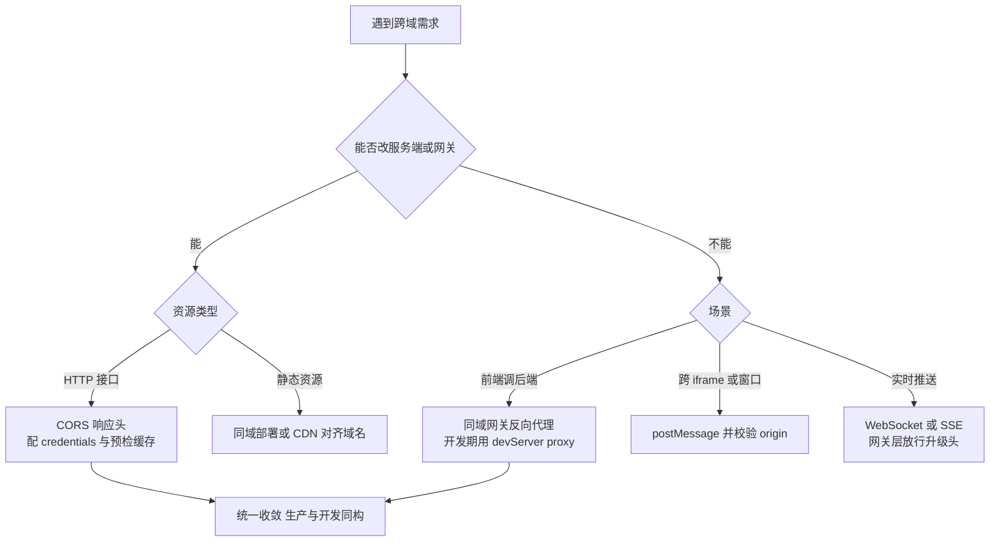

## WEB-195：跨域方案怎么选？给一个决策树。
**答**：
- 一句话原则：能改服务端 → CORS（正统方案）；不能改服务端 → 同域部署或网关代理；纯浏览器间 → postMessage；实时推送 → WebSocket/SSE 配合网关放行。
- 开发环境用 devServer proxy，生产用 nginx 反代或网关统一加 CORS 头，保持两套逻辑同构，避免"本地好好的线上跨域"。
- iframe 场景只有 postMessage（且必须校验 origin）；JSONP 已淘汰，不再建议。
- 升级路径：简单 API 用 CORS；多域名聚合上网关代理；跨窗口/iframe 用 postMessage + MessageChannel。



```json
{
  "devServer": {
    "proxy": {
      "/api": {
        "target": "https://backend.internal",
        "changeOrigin": true,
        "pathRewrite": { "^/api": "" }
      }
    }
  }
}
```
