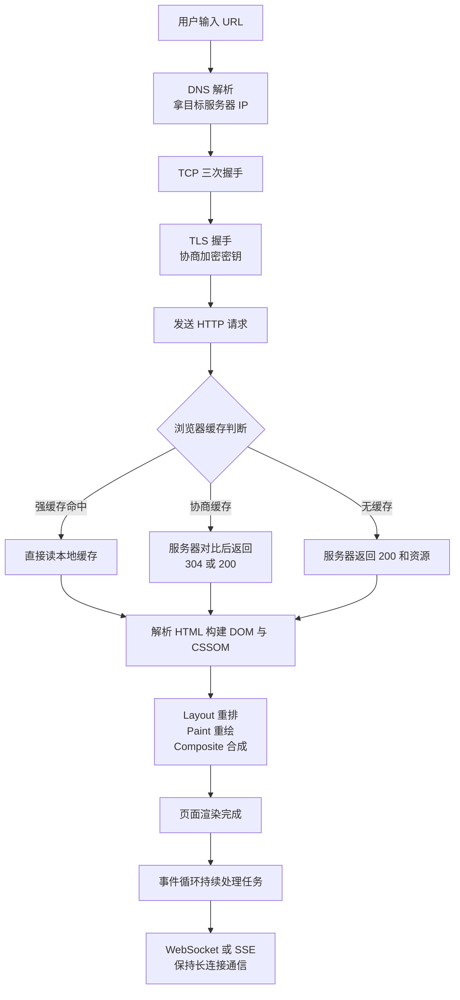

# 前端面试题库：Web / 网络 / 浏览器

本文件收录前端面试中最常考的网络与浏览器知识，覆盖 HTTP 协议演进、HTTPS/TLS、状态码、缓存、Cookie 与 Storage、同源策略与跨域、WebSocket/SSE、DNS/CDN、浏览器渲染、事件循环、Web Workers、PWA、模块化与前端路由。每题配有可直接运行的示例代码或配置，面试时可结合代码展开说明。

## 目录

### 一、HTTP 协议（WEB-001 ~ WEB-010）
### 二、HTTPS 与 TLS（WEB-011 ~ WEB-016）
### 三、状态码（WEB-017 ~ WEB-021）
### 四、浏览器缓存（WEB-022 ~ WEB-028）
### 五、Cookie 与 Web Storage（WEB-029 ~ WEB-033）
### 六、同源策略与跨域（WEB-034 ~ WEB-040）
### 七、WebSocket 与 SSE（WEB-041 ~ WEB-044）
### 八、DNS 与 CDN（WEB-045 ~ WEB-047）
### 九、浏览器渲染流程（WEB-048 ~ WEB-052）
### 十、事件循环（WEB-053 ~ WEB-055）
### 十一、Web Workers、PWA、模块化与前端路由（WEB-056 ~ WEB-060）
### 十二、HTTP 语义进阶（WEB-061 ~ WEB-067）
### 十三、HTTPS 深入（WEB-068 ~ WEB-074）
### 十四、网络性能与传输（WEB-075 ~ WEB-081）
### 十五、浏览器架构与进程（WEB-082 ~ WEB-088）
### 十六、渲染进阶（WEB-089 ~ WEB-095）
### 十七、缓存与存储进阶（WEB-096 ~ WEB-102）
### 十八、安全机制（WEB-103 ~ WEB-109）
### 十九、实时通信进阶（WEB-110 ~ WEB-115）
### 二十、浏览器能力与 API（WEB-116 ~ WEB-123）
### 二十一、综合与演化（WEB-124 ~ WEB-130）
### 二十二、DNS 深入（WEB-131 ~ WEB-136）
### 二十三、代理与网关（WEB-137 ~ WEB-142）
### 二十四、身份认证专题（WEB-143 ~ WEB-150）
### 二十五、安全攻防专题（WEB-151 ~ WEB-158）
### 二十六、浏览器存储与离线深入（WEB-159 ~ WEB-164）
### 二十七、性能采集与分析（WEB-165 ~ WEB-171）
### 二十八、调试与工具（WEB-172 ~ WEB-177）
### 二十九、协议细节陷阱（WEB-178 ~ WEB-183）
### 三十、移动网络与混合环境（WEB-184 ~ WEB-189）
### 三十一、综合排查与收束（WEB-190 ~ WEB-200）

## 一、HTTP 协议

