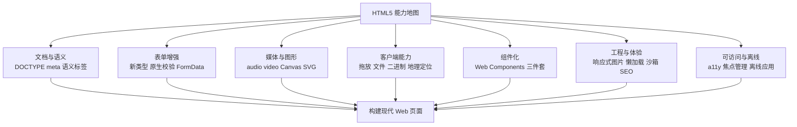

# 前端面试题库：HTML5

本文件聚焦 HTML5 及其配套 API 的面试题，覆盖语义化标签与文档结构、表单增强与校验、audio/video、Canvas 2D、SVG、拖放与文件二进制、地理定位等设备 API、Web Components、响应式图片与懒加载、iframe 沙箱、SEO、无障碍与离线应用。每题配有与题目一一对应的示例代码，概念题也给出了能说明答案的代码或配置。

## 目录

### 一、文档结构与语义化（H5-001 ~ H5-009）
### 二、表单增强与校验（H5-010 ~ H5-015）
### 三、媒体：audio 与 video（H5-016 ~ H5-019）
### 四、Canvas 2D（H5-020 ~ H5-024）
### 五、SVG（H5-025 ~ H5-027）
### 六、拖放与文件二进制（H5-028 ~ H5-033）
### 七、设备与系统 API（H5-034 ~ H5-037）
### 八、Web Components（H5-038 ~ H5-042）
### 九、性能加载与 SEO（H5-043 ~ H5-047）
### 十、无障碍与离线应用（H5-048 ~ H5-050）
### 十一、语义与结构进阶（H5-051 ~ H5-057）
### 十二、表单进阶（H5-058 ~ H5-064）
### 十三、媒体进阶（H5-065 ~ H5-071）
### 十四、Canvas 2D 进阶（H5-072 ~ H5-078）
### 十五、SVG 进阶（H5-079 ~ H5-084）
### 十六、二进制与文件进阶（H5-085 ~ H5-091）
### 十七、设备与传感（H5-092 ~ H5-097）
### 十八、Web Components 深入（H5-098 ~ H5-105）
### 十九、可访问性与国际化深入（H5-106 ~ H5-111）
### 二十、综合与现代 API（H5-112 ~ H5-125）
### 二十一、Canvas 高级渲染（H5-126 ~ H5-132）
### 二十二、Canvas 工程化（H5-133 ~ H5-138）
### 二十三、音视频工程（H5-139 ~ H5-145）
### 二十四、图形与动画 API（H5-146 ~ H5-151）
### 二十五、表单与输入工程（H5-152 ~ H5-157）
### 二十六、文档与可编辑（H5-158 ~ H5-162）
### 二十七、SVG 工程化（H5-163 ~ H5-168）
### 二十八、Web Components 实战（H5-169 ~ H5-173）
### 二十九、无障碍工程实践（H5-174 ~ H5-178）
### 三十、综合案例（H5-179 ~ H5-200）

## 一、文档结构与语义化

