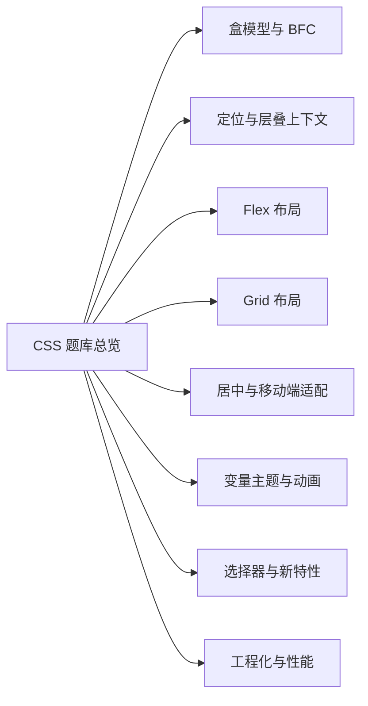

# CSS 面试题库（200 题）

本文件是前端面试工程中的 CSS 题库，覆盖盒模型、BFC、层叠上下文、Flex/Grid 布局、移动端适配、动画与渲染性能、CSS 工程化等核心考点，进阶篇（CSS-061 起）补充选择器进阶、布局实战、响应式设计系统、动画工程、视觉图形、排版、组件样式模式、CSS 架构、性能渲染与新特性兼容十个专题，高级篇（CSS-131 起）补充经典布局全解、Flex/Grid 深水区、动效实战、复杂组件还原、主题与设计系统、移动端深坑、CSS 与 JS 协作、调试质量与综合体系十个专题。每题配有与题目一一对应的可运行代码示例，答案采用要点式归纳，适合系统复习与面试前快速过题。

## 目录

- 一、盒模型与 margin（CSS-001 ~ CSS-008）
- 二、BFC 与 IFC（CSS-009 ~ CSS-012）
- 三、定位与层叠上下文（CSS-013 ~ CSS-018）
- 四、Flex 布局（CSS-019 ~ CSS-027）
- 五、Grid 布局（CSS-028 ~ CSS-033）
- 六、居中方案（CSS-034 ~ CSS-037）
- 七、移动端适配与媒体查询（CSS-038 ~ CSS-042）
- 八、CSS 变量与主题切换（CSS-043 ~ CSS-045）
- 九、transition、animation 与渲染性能（CSS-046 ~ CSS-051）
- 十、伪类伪元素、优先级与继承（CSS-052 ~ CSS-056）
- 十一、CSS 工程化与性能（CSS-057 ~ CSS-060）
- 十二、选择器进阶（CSS-061 ~ CSS-066）
- 十三、布局专题实战（CSS-067 ~ CSS-074）
- 十四、响应式设计系统（CSS-075 ~ CSS-081）
- 十五、动画工程（CSS-082 ~ CSS-088）
- 十六、视觉与图形（CSS-089 ~ CSS-095）
- 十七、文字排版（CSS-096 ~ CSS-101）
- 十八、组件样式模式（CSS-102 ~ CSS-108）
- 十九、CSS 架构方法（CSS-109 ~ CSS-115）
- 二十、性能与渲染（CSS-116 ~ CSS-121）
- 二十一、新特性与兼容（CSS-122 ~ CSS-130）
- 二十二、经典布局题全解（CSS-131 ~ CSS-138）
- 二十三、Flex 深水区（CSS-139 ~ CSS-145）
- 二十四、Grid 深水区（CSS-146 ~ CSS-152）
- 二十五、动效实战案例（CSS-153 ~ CSS-159）
- 二十六、复杂组件样式还原（CSS-160 ~ CSS-166）
- 二十七、主题与设计系统落地（CSS-167 ~ CSS-172）
- 二十八、移动端深坑全解（CSS-173 ~ CSS-178）
- 二十九、CSS 与 JS 协作（CSS-179 ~ CSS-184）
- 三十、调试与质量（CSS-185 ~ CSS-190）
- 三十一、综合与体系（CSS-191 ~ CSS-200）

## 一、盒模型与 margin

