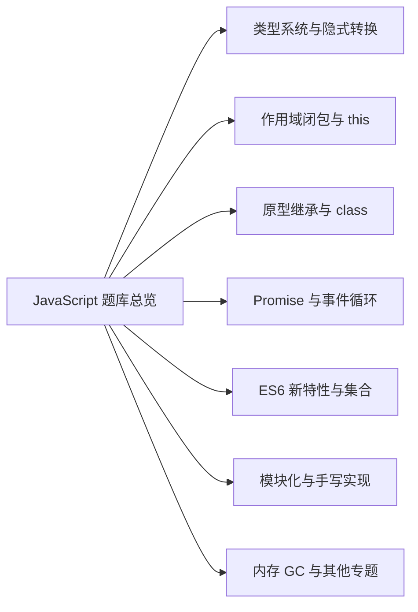

# JavaScript 面试题库（140 题）

本文件是前端面试工程中的 JavaScript 题库，覆盖数据类型与隐式转换、作用域与闭包、this 与 call/apply/bind、原型与继承、class、Promise 与 async/await、事件循环、ES6+ 新特性、Map/Set/WeakMap、Proxy/Reflect、模块化、手写实现、内存与 GC、严格模式、迭代器、正则、错误处理、事件委托与 requestAnimationFrame 等考点。每题配有与题目一一对应的代码示例，答案采用要点式归纳。

## 目录

- 一、数据类型与隐式转换（JS-001 ~ JS-010）
- 二、作用域与闭包（JS-011 ~ JS-018）
- 三、this 与 call/apply/bind（JS-019 ~ JS-025）
- 四、原型、继承与 class（JS-026 ~ JS-033）
- 五、Promise 与异步（JS-034 ~ JS-042）
- 六、事件循环与宏微任务（JS-043 ~ JS-048）
- 七、ES6+ 新特性（JS-049 ~ JS-057）
- 八、Map/Set/WeakMap 与 Proxy/Reflect（JS-058 ~ JS-063）
- 九、模块化（JS-064 ~ JS-066）
- 十、手写实现（JS-067 ~ JS-072）
- 十一、内存、严格模式与其他专题（JS-073 ~ JS-080）
- 十二、手写实现进阶（JS-081 ~ JS-088）
- 十三、异步编程深水区（JS-089 ~ JS-095）
- 十四、对象与元编程（JS-096 ~ JS-102）
- 十五、函数式编程（JS-103 ~ JS-108）
- 十六、类型系统与运行时（JS-109 ~ JS-114）
- 十七、浏览器交互与存储（JS-115 ~ JS-120）
- 十八、错误处理与调试（JS-121 ~ JS-126）
- 十九、模块化与工程（JS-127 ~ JS-140）
- 二十、综合输出题压轴（JS-141 ~ JS-146）
- 二十一、手写轮子压轴（JS-147 ~ JS-153）
- 二十二、数据结构与算法思维在 JS（JS-154 ~ JS-159）
- 二十三、DOM 与事件深入（JS-160 ~ JS-165）
- 二十四、浏览器 API 编程（JS-166 ~ JS-171）
- 二十五、工程与规范（JS-172 ~ JS-177）
- 二十六、内存与性能（JS-178 ~ JS-183）
- 二十七、综合设计题（JS-184 ~ JS-200）

## 一、数据类型与隐式转换

