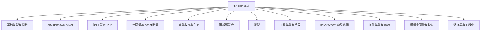

# TypeScript 前端面试题库

本文件收录 200 道 TypeScript 面试题，编号 TS-001 ~ TS-200，覆盖基础类型与推断、any/unknown/never、接口与类型别名、联合/交叉类型、字面量类型与 const 断言、类型收窄与类型守卫、可辨识联合、泛型、内置工具类型与手写实现、keyof/typeof/索引访问、条件类型与 infer、模板字面量类型、映射类型、装饰器、tsconfig 配置、declare 声明文件、enum、协变逆变以及典型类型体操；后半部分（TS-061 ~ TS-130）聚焦大厂高频类型体操与工程实践，包括工具类型手写进阶、infer 高阶、分布式条件类型深水区、字符串与对象类型体操、泛型组件与业务类型设计、TS 与运行时边界、大厂 TS 规范落地；TS-131 ~ TS-200 进一步覆盖框架级 TS 应用（Vue3/React 深入）、工具类型库源码级精选、高阶体操挑战、递归类型与性能、模块与声明进阶、类型安全的状态与路由、TS 元编程进阶、严格度与错误治理以及综合大题收束。每题均配有与题目一一对应的代码示例，不包含任何算法题。

## 目录

- 第一章 基础类型与类型推断（TS-001 ~ TS-008）
- 第二章 any、unknown 与 never（TS-009 ~ TS-013）
- 第三章 接口、类型别名与联合交叉（TS-014 ~ TS-018）
- 第四章 字面量类型与 const 断言（TS-019 ~ TS-021）
- 第五章 类型收窄与类型守卫（TS-022 ~ TS-026）
- 第六章 可辨识联合（TS-027 ~ TS-029）
- 第七章 泛型（TS-030 ~ TS-034）
- 第八章 工具类型与手写实现（TS-035 ~ TS-041）
- 第九章 keyof、typeof 与索引访问（TS-042 ~ TS-044）
- 第十章 条件类型与 infer（TS-045 ~ TS-048）
- 第十一章 模板字面量类型（TS-049 ~ TS-050）
- 第十二章 映射类型（TS-051 ~ TS-052）
- 第十三章 装饰器（TS-053）
- 第十四章 tsconfig 常用配置（TS-054 ~ TS-055）
- 第十五章 declare 与声明文件（TS-056）
- 第十六章 enum 与 const enum（TS-057）
- 第十七章 协变与逆变（TS-058）
- 第十八章 类型体操典型题（TS-059 ~ TS-060）
- 第十九章 工具类型手写进阶（TS-061 ~ TS-068）
- 第二十章 infer 高阶（TS-069 ~ TS-075）
- 第二十一章 条件类型与分布式深水区（TS-076 ~ TS-082）
- 第二十二章 类型体操经典题（TS-083 ~ TS-090）
- 第二十三章 字符串类型体操（TS-091 ~ TS-097）
- 第二十四章 对象类型体操（TS-098 ~ TS-104）
- 第二十五章 数组与元组体操（TS-105 ~ TS-111）
- 第二十六章 泛型组件与业务类型设计（TS-112 ~ TS-118）
- 第二十七章 TS 与运行时边界（TS-119 ~ TS-124）
- 第二十八章 TS 工程与大厂实战（TS-125 ~ TS-130）
- 第二十九章 Vue3 中的 TS 深入（TS-131 ~ TS-136）
- 第三十章 React 中的 TS 深入（TS-137 ~ TS-142）
- 第三十一章 工具类型库源码级精选（TS-143 ~ TS-149）
- 第三十二章 高阶体操挑战（TS-150 ~ TS-157）
- 第三十三章 递归类型与性能（TS-158 ~ TS-163）
- 第三十四章 模块与声明进阶（TS-164 ~ TS-169）
- 第三十五章 类型安全的状态与路由（TS-170 ~ TS-175）
- 第三十六章 TS 元编程进阶（TS-176 ~ TS-181）
- 第三十七章 严格度与错误治理（TS-182 ~ TS-187）
- 第三十八章 综合大题（TS-188 ~ TS-200）

## 第一章 基础类型与类型推断

