# 前端面试题库：基础速答 200 题

本文件是"一题一考点"的基础速答题库，专门收录 01~09 专题未展开细讲的高频基础点：HTML 文档常识、CSS 速记、JS 基础类型与常用 API、浏览器与调试技巧、HTTP 速答、工程与命令行。题目短、答案准，适合面试前最后一轮快速过题，与已有专题形成互补而不重复。

```mermaid
flowchart TD
    A[基础速答题库<br/>BAS-001 ~ BAS-200] --> B[HTML 与文档基础<br/>BAS-001 ~ BAS-010]
    A --> C[CSS 速答<br/>BAS-011 ~ BAS-018]
    A --> D[JavaScript 基础<br/>BAS-019 ~ BAS-034]
    A --> E[浏览器与调试<br/>BAS-035 ~ BAS-042]
    A --> F[HTTP 与网络<br/>BAS-043 ~ BAS-045]
    A --> G[工程与命令行<br/>BAS-046 ~ BAS-050]
    A --> H[HTML 补充<br/>BAS-051 ~ BAS-061]
    A --> I[CSS 补充<br/>BAS-062 ~ BAS-080]
    A --> J[JS 语法补充<br/>BAS-081 ~ BAS-094]
    A --> K[DOM 与事件补充<br/>BAS-095 ~ BAS-104]
    A --> L[网络与浏览器补充<br/>BAS-105 ~ BAS-111]
    A --> M[TypeScript 与工程补充<br/>BAS-112 ~ BAS-120]
    A --> N[综合速答<br/>BAS-121 ~ BAS-125]
    A --> O[深入 JS 语义<br/>BAS-126 ~ BAS-140]
    A --> P[异步与事件循环补充<br/>BAS-141 ~ BAS-150]
    A --> Q[CSS 进阶速答<br/>BAS-151 ~ BAS-162]
    A --> R[HTTP 与安全速答补充<br/>BAS-163 ~ BAS-172]
    A --> S[浏览器与渲染补充<br/>BAS-173 ~ BAS-180]
    A --> T[Node 与 CLI 基础<br/>BAS-181 ~ BAS-188]
    A --> U[工具与规范速答<br/>BAS-189 ~ BAS-195]
    A --> V[综合辨析<br/>BAS-196 ~ BAS-200]
```

## 目录

### 一、HTML 与文档基础（BAS-001 ~ BAS-010）
### 二、CSS 速答（BAS-011 ~ BAS-018）
### 三、JavaScript 基础（BAS-019 ~ BAS-034）
### 四、浏览器与调试（BAS-035 ~ BAS-042）
### 五、HTTP 与网络速答（BAS-043 ~ BAS-045）
### 六、工程与命令行（BAS-046 ~ BAS-050）
### 七、HTML 补充（BAS-051 ~ BAS-061）
### 八、CSS 补充·布局与交互（BAS-062 ~ BAS-070）
### 九、CSS 补充·视觉与排版（BAS-071 ~ BAS-080）
### 十、JavaScript 语法补充（BAS-081 ~ BAS-094）
### 十一、DOM 与事件补充（BAS-095 ~ BAS-104）
### 十二、网络与浏览器补充（BAS-105 ~ BAS-111）
### 十三、TypeScript 与工程基础补充（BAS-112 ~ BAS-120）
### 十四、综合速答（BAS-121 ~ BAS-125）
### 十五、深入 JS 语义（BAS-126 ~ BAS-140）
### 十六、异步与事件循环补充（BAS-141 ~ BAS-150）
### 十七、CSS 进阶速答（BAS-151 ~ BAS-162）
### 十八、HTTP 与安全速答补充（BAS-163 ~ BAS-172）
### 十九、浏览器与渲染补充（BAS-173 ~ BAS-180）
### 二十、Node 与 CLI 基础（BAS-181 ~ BAS-188）
### 二十一、工具与规范速答（BAS-189 ~ BAS-195）
### 二十二、综合辨析（BAS-196 ~ BAS-200）

## 一、HTML 与文档基础

