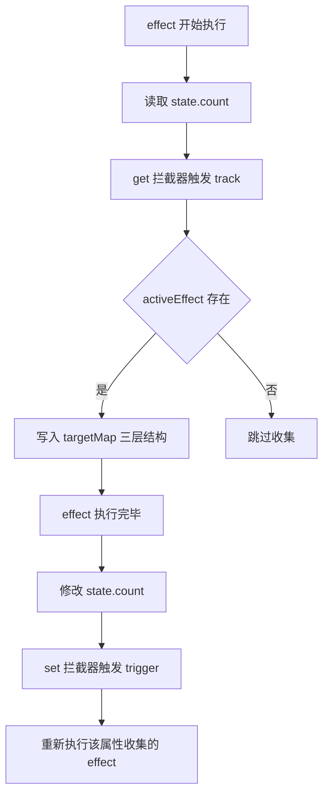

## FRP-002：Vue3 依赖收集的三层 WeakMap 结构是怎样的？为什么用 WeakMap？

**答**：
- 结构：`WeakMap<target对象, Map<属性key, Set<effect>>>`——第一层按对象、第二层按属性、第三层去重的 effect 集合。
- WeakMap 的 key 是弱引用：组件销毁、对象无引用后，整个依赖表随之被 GC，**无需手动清理**，这是选 WeakMap 而不是 Map 的决定性原因。
- 第二层用 Map 而非对象：key 可能是 Symbol；第三层用 Set：天然去重（一个 effect 读同一属性多次只收集一次）。
- effect 执行前还会做 cleanup（从旧依赖中移除自己），解决条件分支切换导致的遗留依赖。



```javascript
// 简化实现，帮助理解三层结构与 GC 关系
const targetMap = new WeakMap();

function getDep(target, key) {
  let depsMap = targetMap.get(target);        // 第一层：WeakMap，key 是被代理的原始对象
  if (!depsMap) targetMap.set(target, (depsMap = new Map()));
  let dep = depsMap.get(key);                 // 第二层：Map，key 是属性名（含 Symbol）
  if (!dep) depsMap.set(key, (dep = new Set())); // 第三层：Set，去重的 effect
  return dep;
}

// 弱引用验证：对象失去引用后，targetMap 中对应条目会被 GC
let user = { name: 'wang' };
getDep(user, 'name').add(() => console.log('effect'));
console.log(targetMap.has(user)); // true
user = null;                      // 解除引用
// 等待 GC 后，WeakMap 中 { name: wang } 的依赖记录随之回收，不会内存泄漏
```
