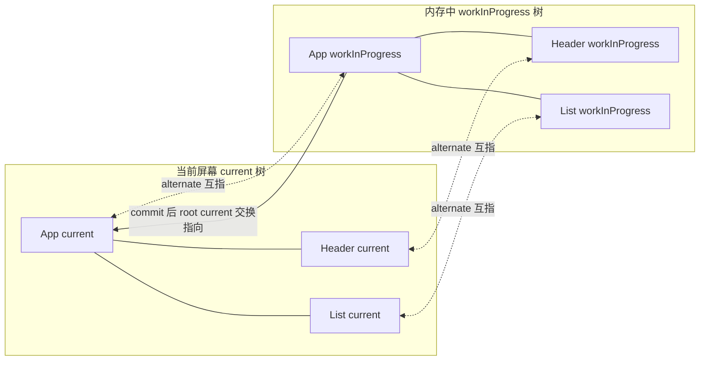

## FRP-024：什么是双缓冲 Fiber 树？alternate 如何工作？

**答**：
- React 内存中常驻两棵 Fiber 树：`current`（屏幕上正在显示的，其 DOM 已提交）与 `workInProgress`（正在内存里构建的下一帧）。
- 每个节点通过 `alternate` 互相指向：构建 workInProgress 时优先**复用 current.alternate 的旧 Fiber 对象**（连带 stateNode 即真实 DOM），只更新变化的 props/state。
- render 完成后 commit，workInProgress 变成新的 current（`root.current = finishedWork`）——"双份缓冲区、提交时交换"，与显卡双缓冲同构。
- 收益：渲染期间屏幕始终展示完整的 current 树，可中断、可丢弃、可重放，不会出现"渲染到一半的 UI"。



```javascript
// 简化实现，帮助理解双缓冲与节点复用
function createWorkInProgress(current, pendingProps) {
  let work = current.alternate;
  if (work === null) {
    // 首次：克隆一个新 Fiber 作为双缓冲
    work = {
      type: current.type,
      key: current.key,
      stateNode: current.stateNode, // 关键：复用真实 DOM，不是重新创建
      flags: 0,
      lanes: 0,
    };
    work.alternate = current;
    current.alternate = work;       // 互指
  } else {
    // 已有 alternate：就地复用，重置副作用标记即可
    work.flags = 0;
  }
  work.props = pendingProps;        // 用新 props
  work.child = null;
  work.memoizedState = current.memoizedState;
  return work;
}

// 更新流程（示意）
let root = { current: buildInitialFiberTree() }; // current 树

function scheduleUpdateOnFiber(fiber) {
  const wipRoot = createWorkInProgress(root.current, root.current.props);
  renderPhase(wipRoot);            // render 阶段：内存里构建新树，可中断
  commitPhase(wipRoot);            // commit 阶段：一次性应用 DOM 变更
  root.current = wipRoot;          // 提交完成：交换，新树成为 current
}
```
