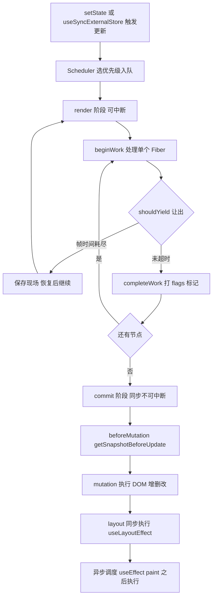

## FRP-025：React 的 render 阶段与 commit 阶段各自做什么？为什么这样划分？

**答**：
- **render 阶段**（Reconciler）：从 root 开始 beginWork/completeWork 遍历，执行 render 函数、计算 diff、在 Fiber 上打 flags 标记——**纯计算、无副作用、可中断**。
- **commit 阶段**（Renderer）：把 flags 同步执行到 DOM（beforeMutation/mutation/layout 三个子阶段），依次触发 getSnapshotBeforeUpdate、DOM 操作、useLayoutEffect，最后异步调度 useEffect——**同步不可中断**，避免用户看到中间状态。
- 划分原因：可中断只能发生在"不碰真实 DOM"的阶段；一旦开始改 DOM 就必须一口气完成，否则视觉不一致。
- 生命周期的归属也由此决定：UNSAFE_componentWillReceiveProps 等在可中断的 render 阶段可能被多次执行，因此被标记 UNSAFE（见 useEffect 时机题）。



```javascript
// 简化实现，帮助理解两阶段划分
function renderRootSync(rootFiber) {
  // ===== render 阶段：纯计算，可中断，不碰 DOM =====
  let fiber = rootFiber;
  while (fiber) {
    beginWork(fiber);    // 执行函数组件 render 或类组件 render，diff 出子 Fiber
    // 真实源码在这里检查 shouldYield()，可暂停恢复（见 FRP-027）
    if (fiber.child) { fiber = fiber.child; continue; }
    while (fiber) {
      completeWork(fiber); // 生成/更新 DOM 描述，向父级冒泡 flags
      if (fiber.sibling) { fiber = fiber.sibling; break; }
      fiber = fiber.return;
    }
  }
  commitRoot(rootFiber);   // render 完成，进入同步 commit
}

function commitRoot(rootFiber) {
  // ===== commit 阶段：同步一口气完成，不可中断 =====
  // 1. beforeMutation：getSnapshotBeforeUpdate（拿到更新前 DOM 快照）
  // 2. mutation：按 flags 执行真实 DOM 操作
  const deletions = [], insertions = [], updates = [];
  collectFlags(rootFiber, { deletions, insertions, updates });
  deletions.forEach((d) => d.stateNode.remove());
  insertions.forEach((i) => i.parent.insertBefore(i.node.stateNode, i.before));
  updates.forEach((u) => Object.assign(u.node.stateNode, u.props));

  // 3. layout：同步执行 useLayoutEffect / componentDidMount
  flushLayoutEffects(rootFiber);

  // 4. passive：useEffect 调度到 paint 之后（宏任务/微任务）
  schedulePassiveEffects(rootFiber);
}
```
