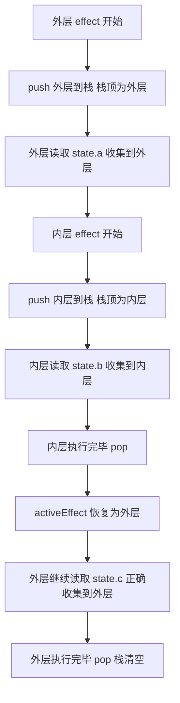

## FRP-052：为什么 effect 需要用栈（effectStack）管理？嵌套 effect 会出什么问题？

**答**：
- 如果只用一个全局变量 `activeEffect`，**内层 effect 执行完会把 activeEffect 置空或覆盖**：外层 effect 后续读取属性时，依赖被错误地收集到内层 effect 上。
- 典型后果：外层再也不更新（收集到了错误的 effect），内层反而被多余地触发——这是高频手写追问点。
- 解决：用一个**栈**维护执行中的 effect，进入时 push、退出时 pop，并把 `activeEffect` 恢复为栈顶；track 永远收集栈顶。
- Vue3 源码 `ReactiveEffect.run` 中正是用 `effectStack.push(this)` + `activeEffect = this` 实现的。



```javascript
// 简化实现，帮助理解 effectStack 解决嵌套收集错乱
let activeEffect = null;
const effectStack = [];
const targetMap = new WeakMap();

function track(target, key) {
  if (!activeEffect) return;
  let depsMap = targetMap.get(target);
  if (!depsMap) targetMap.set(target, (depsMap = new Map()));
  let dep = depsMap.get(key);
  if (!dep) depsMap.set(key, (dep = new Set()));
  dep.add(activeEffect); // 永远收集栈顶，嵌套时不会错挂
}

function effect(fn) {
  const effectFn = () => {
    effectStack.push(effectFn);
    activeEffect = effectFn;
    try {
      fn();
    } finally {
      effectStack.pop();
      activeEffect = effectStack[effectStack.length - 1] || null; // 恢复外层
    }
  };
  effectFn();
  return effectFn;
}

const obj = reactive({ a: 1, b: 2 }); // 假设 reactive 内部 get 调 track
effect(() => {
  console.log('outer a =', obj.a);
  effect(() => console.log('inner b =', obj.b)); // 嵌套
  console.log('outer read again a =', obj.a);    // 必须仍收集到 outer
});
obj.a = 10; // outer 重跑两次读取均生效；若是无栈实现，这行将不触发 outer
```
