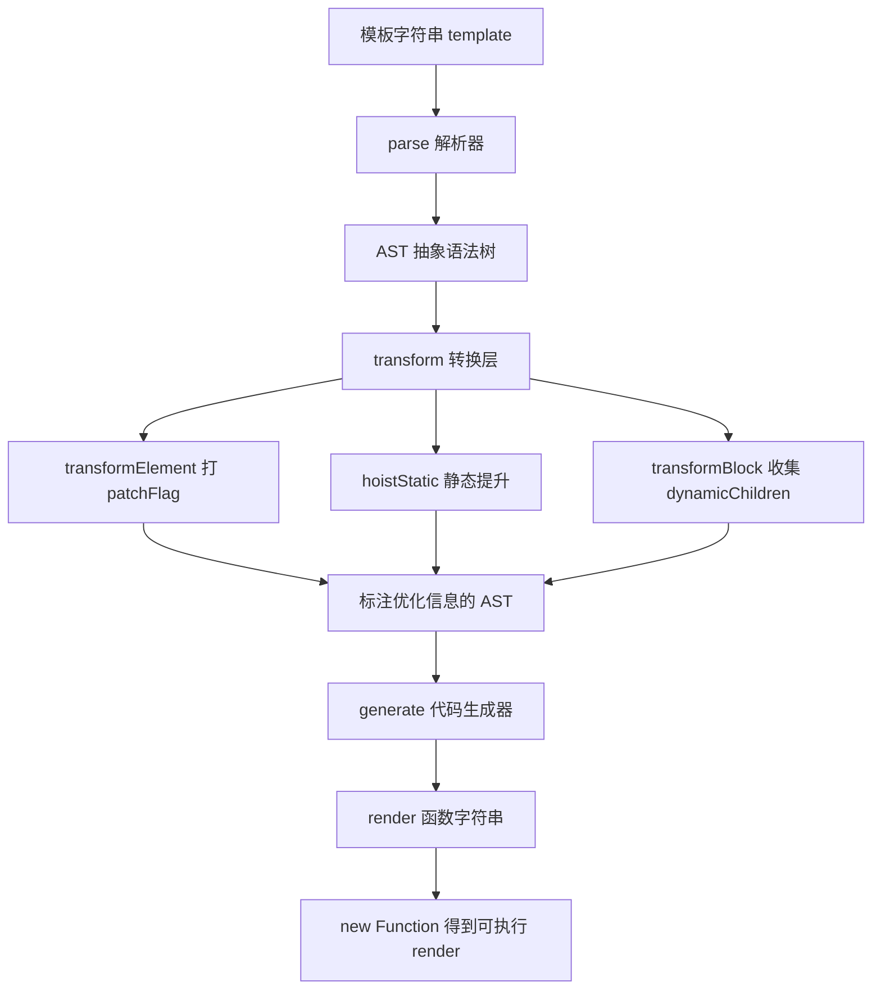

## FRP-058：Vue 模板编译的三阶段 parse → transform → generate 各做什么？为什么要拆成三段？

**答**：
- **parse**：把模板字符串解析成 **AST**（抽象语法树），处理标签、属性、插值、指令、嵌套结构，输出 `{ type: ROOT, children: [...] }` 树。
- **transform**：对 AST 做**转换层遍历**，一系列插件式 transform（transformElement、transformExpression、hoistStatic、transformBlock 等）往节点上打 **patchFlag / dynamicChildren / helpers** 信息——所有"编译优化"都发生在这一层。
- **generate**：把标注好的 AST 生成为 **render 函数字符串**（`_createElementBlock(...)` 之类），再经 `new Function` 得到可执行 render。
- 拆三段的价值：输入输出解耦（AST 是中间表示 IR），优化逻辑只动 transform 层；这也是 Vue3 能做 patchFlag 而手写 render 函数拿不到这些信息的根因。



```javascript
// 简化实现，帮助理解编译三阶段流水线
// 1. parse：极简 HTML -> AST
function parse(template) {
  const stack = [{ type: 'Root', children: [] }];
  const re = /<\/?([a-z]+)[^>]*>|(?<=^|>)\{\{([^}]+)\}\}([^<]*)/g;
  let text = template;
  // 真实实现是逐 token 的状态机，这里演示分层调用关系
  const ast = { type: 'Root', children: [] };
  for (const m of template.matchAll(/<([a-z]+)([^>]*)>([\s\S]*?)<\/\1>/g)) {
    const node = { type: 'Element', tag: m[1], props: m[2].trim(), children: [] };
    const interp = m[3].match(/\{\{(.+?)\}\}/);
    if (interp) node.children.push({ type: 'Interpolation', content: interp[1].trim() });
    else if (m[3].trim()) node.children.push({ type: 'Text', content: m[3].trim() });
    ast.children.push(node);
  }
  return ast;
}

// 2. transform：遍历 AST，打优化标记
function transform(ast) {
  ast.children.forEach(function walk(node, index) {
    node.patchFlag = 0;
    if (node.type === 'Element') {
      if (/\{\{/.test(node.props)) node.patchFlag |= 2;        // PROPS 类标记
      node.children.forEach((c, i) => walk(c, i));
    }
    if (node.type === 'Interpolation') node.patchFlag = 1;      // TEXT
  });
  return ast;
}

// 3. generate：AST -> render 函数字符串
function generate(ast) {
  const gen = (n) =>
    n.type === 'Text' ? JSON.stringify(n.content)
    : n.type === 'Interpolation' ? `_ctx.${n.content}`
    : `h("${n.tag}"${n.patchFlag ? `, ${n.patchFlag}` : ''}, ${JSON.stringify(n.props) || '{}'}, [${n.children.map(gen).join(', ')}])`;
  return `_render = () => ${ast.children.map(gen).join(',\n') || 'null'}`;
}

const code = generate(transform(parse('<p>{{ count }}</p>')));
console.log(code); // _render = () => h("p", 1, {}, [_ctx.count])
```
