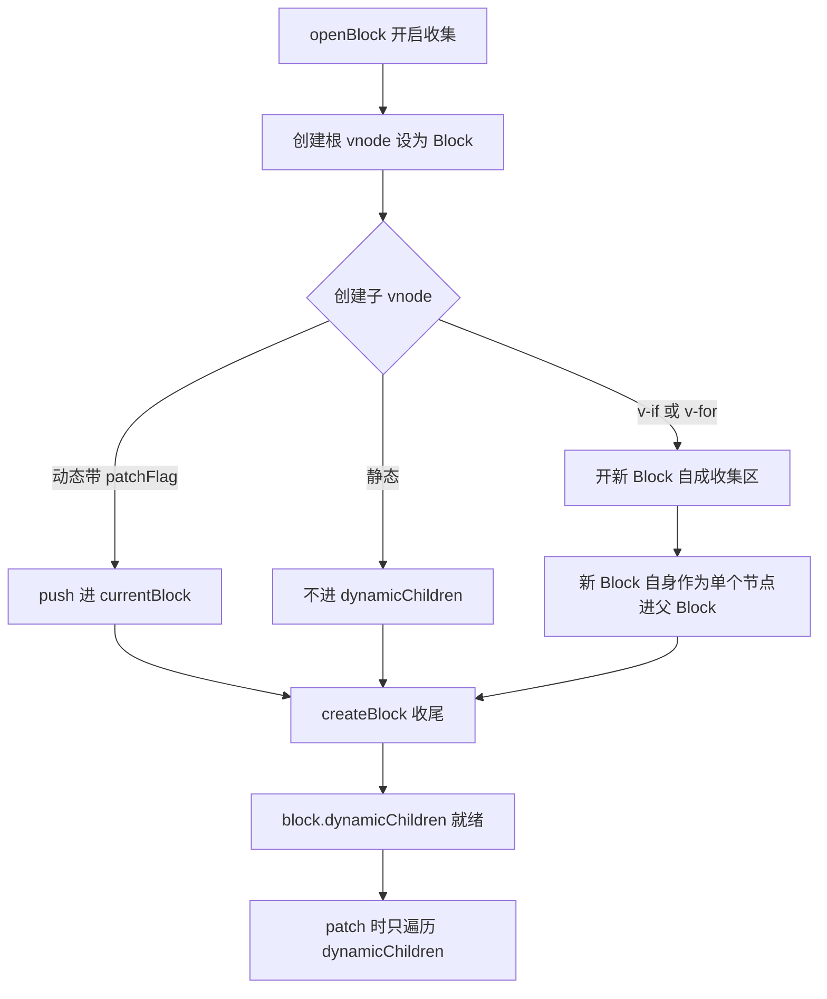

## FRP-062：Block Tree 与 dynamicChildren 收集原理是什么？v-if / v-for 为什么会"打断"Block？

**答**：
- 编译器把每个 vnode 打上** openBlock/createBlock**：`openBlock()` 开一个空数组 `currentBlock`，之后创建的**动态 vnode** 在自身创建时把自己 push 进该数组（静态 vnode 不进），`createBlock` 收尾把数组存为 `block.dynamicChildren`——这就是 Block Tree。
- patch 时对 block 只遍历 **dynamicChildren（数量远小于全子树）** 逐一 patchElement，配合 patchFlag 每个节点 O(属性数) 而不是 O(子树)。
- **结构不稳定必须开新 Block**：v-if/v-for 的分支个数、子节点顺序在运行期可变，父 block 里的 dynamicChildren 按旧结构收集的索引会错位——所以 v-if 生成的是"新 block"（每个分支一个 block），v-for 的每个 fragment 子项断开父级收集（children 收集到 Fragment 自己的 block），保证"Block 内结构恒定"这一前提。
- 全局 `currentBlock` 用**栈式**管理：子 block 创建完毕 `pop` 后，其内部收集的动态节点不再混入父 block。



```javascript
// 简化实现，帮助理解 Block 与 dynamicChildren 收集
let currentBlock = null; // 栈：支持 block 嵌套

function openBlock() { currentBlock = []; }
function createBlock(vnode) {
  vnode.dynamicChildren = currentBlock; // 收尾：把收集数组挂到自己身上
  currentBlock = null;
  return vnode;
}
function createVNode(tag, props = {}, children = null) {
  const isStatic = !props.patchFlag;
  if (currentBlock && !isStatic) currentBlock.push(vnode); // 动态节点自注册
  return vnode;
}

// 编译产物形态：div 内有动态文本与静态节点
function render(_ctx) {
  openBlock();
  return createBlock(createVNode('div', null, [
    'static text',                                    // 静态：不进收集
    createVNode('span', { patchFlag: 1 }, _ctx.msg),  // 动态 TEXT：进入收集
    createVNode('b', null, 'static bold'),            // 静态
  ]));
}

function patchBlock(oldBlock, newBlock) {
  // 只 diff 动态节点数组，与真实 DOM 树结构解耦
  newBlock.dynamicChildren?.forEach((v, i) => {
    const old = oldBlock.dynamicChildren?.[i];
    if (old && old.patchFlag === 1 && old.children !== v.children) {
      console.log('patch text:', v.children); // 快速路径
    }
  });
}

const v1 = render({ msg: 'a' });
openBlock(); const v2 = render({ msg: 'b' }); // 模拟重渲染
console.log('动态节点数:', v1.dynamicChildren.length); // 1，全子树是 3
patchBlock(v1, v2); // patch text: b
```
