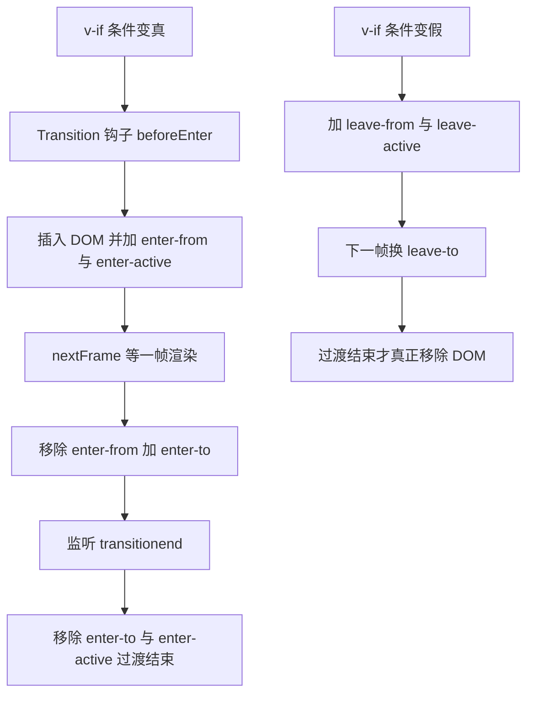

## FRP-071：Transition 组件的实现原理是什么？enter 阶段的 class 是怎么切换的？

**答**：
- Transition 是**无自身 DOM 的抽象组件**：渲染时直接返回**单个子元素 vnode**，并在子元素上附加 enter/leave 钩子（via renderer 的 `processElement` beforeEnter/enter/afterEnter 等），把过渡时机与 DOM 增删对齐。
- enter 序列：元素插入 DOM 前加 `*-enter-from`（初始态）与 `*-enter-active`（过渡属性），**下一帧**移除 enter-from、加 `*-enter-to`（目标态）；transitionend 后移除 active/to。两帧切换是浏览器渲染机制决定的——同帧改 class 不会触发过渡。
- leave 序列对称：离开前加 leave-from/leave-active，下一帧换 leave-to，监听 `transitionend/animationend`（或 `duration` prop 显式指定）后真正移除 DOM。
- name 属性决定前缀；`mode="out-in"` 控制先播放旧元素 leave 再进入新元素（用一个"延迟插入"的调度实现）；`appear` 控制初次渲染也走 enter。



```javascript
// 简化实现，帮助理解 Transition 的 class 切换时序
const nextFrame = (cb) => requestAnimationFrame(() => requestAnimationFrame(cb));
const whenTransitionEnds = (el, done) => {
  const onEnd = (e) => { el.removeEventListener('transitionend', onEnd); done(); };
  el.addEventListener('transitionend', onEnd);
};

function transitionHook(el, state, enter) {
  const name = 'fade'; // :name="fade" -> .fade-enter-from 等
  if (enter) {
    el.classList.add(`${name}-enter-from`, `${name}-enter-active`);
    document.body.appendChild(el);                       // 插入 DOM（带初始态）
    nextFrame(() => {
      el.classList.remove(`${name}-enter-from`);         // 第二帧：起始态撤掉
      el.classList.add(`${name}-enter-to`);              // -> 触发过渡动画
      whenTransitionEnds(el, () =>
        el.classList.remove(`${name}-enter-to`, `${name}-enter-active`));
    });
  } else {
    el.classList.add(`${name}-leave-from`, `${name}-leave-active`);
    nextFrame(() => {
      el.classList.remove(`${name}-leave-from`);
      el.classList.add(`${name}-leave-to`);
      whenTransitionEnds(el, () => {
        el.classList.remove(`${name}-leave-to`, `${name}-leave-active`);
        el.remove();                                     // 过渡结束才真正移除
      });
    });
  }
}

/* 配套 CSS：
.fade-enter-from   { opacity: 0 }
.fade-enter-active { transition: opacity .3s }
.fade-enter-to     { opacity: 1 }
.fade-leave-from   { opacity: 1 }
.fade-leave-active { transition: opacity .3s }
.fade-leave-to     { opacity: 0 }
*/
// 验证：切换一个 v-if 元素，观察 class 序列 enter-from -> enter-to -> 清空
const el = document.createElement('div');
transitionHook(el, {}, true); // enter 流程演示
```
