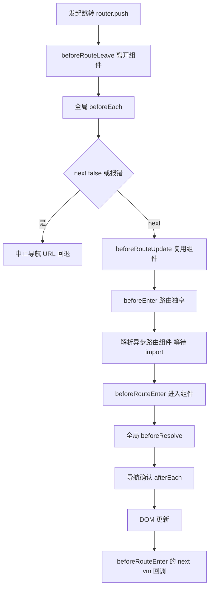

## FRP-075：一次路由跳转中导航守卫的完整执行时序是怎样的？

**答**：
- 完整顺序（以跳转为例）：**beforeRouteLeave**（离开组件）→ **全局 beforeEach** → **beforeRouteUpdate**（复用组件）→ **beforeEnter**（路由独享）→ **解析异步路由组件**（懒加载 import 等待）→ **beforeRouteEnter**（进入组件）→ **全局 beforeResolve** → 导航确认 → **全局 afterEach** → **DOM 更新** → beforeRouteEnter 的 `next(vm)` 回调（此时实例可用）。
- 异步组件在守卫链中段解析：`router.beforeEach` 之后、beforeRouteEnter 之前，Route 会等待 `() => import()` 完成，这是"守卫里读不到组件"但"能拦截懒加载"的原因。
- 任一环节 `next(false)` / `return false` / 抛错 → **中止并回退 URL**（若 URL 已 push 则 revert）；重定向 `next('/other')` 则重新走一遍完整流程（注意防死循环）。
- 简化记忆：**离开 → 全局前置 → 路由级 → 组件级 → 解析确认 → 全局后置 → DOM → 实例回调**。



```javascript
// 简化实现，帮助理解守卫链的串联与中断
function createRouterGuards() {
  const guards = { beforeEach: [], afterEach: [] };
  return {
    beforeEach: (fn) => guards.beforeEach.push(fn),
    afterEach: (fn) => guards.afterEach.push(fn),
    async navigate(to, from, routeRecord) {
      const log = [];
      const abort = () => { throw new Error('NAV_ABORTED'); };
      // next 简化为三种形态：无参继续 / false 中止 / 路径重定向
      const next = (arg) => (arg === false ? abort()
        : typeof arg === 'string' ? this.navigate(arg, from, routeRecord) : undefined);
      try {
        log.push('leave');                                  // beforeRouteLeave
        for (const g of guards.beforeEach) { log.push('beforeEach'); await g(to, from, next); }
        if (routeRecord?.beforeEnter) { log.push('beforeEnter'); await routeRecord.beforeEnter(to, from, next); }
        if (typeof routeRecord?.component === 'function') {
          log.push('resolve async component');              // 等待懒加载
          routeRecord.component = await routeRecord.component();
        }
        log.push('beforeRouteEnter');                       // 无实例，只有 next(vm)
        for (const g of guards.beforeEach) void g;          // beforeResolve 同理
        log.push('confirmed');
        for (const g of guards.afterEach) g(to, from);
        return log;
      } catch (e) {
        if (e.message === 'NAV_ABORTED') return [...log, 'aborted'];
        throw e;
      }
    },
  };
}

const router = createRouterGuards();
router.beforeEach(async (to, from, next) => {
  if (to === '/admin' && !localStorage.token) next(false);
  else next();
});
const record = { path: '/detail', component: () => Promise.resolve({ template: '<div/>' }) };
router.navigate('/detail', '/', record).then((log) =>
  console.log('守卫时序:', log.join(' -> ')));
// 守卫时序: leave -> beforeEach -> beforeEnter -> resolve async component -> beforeRouteEnter -> confirmed
```
