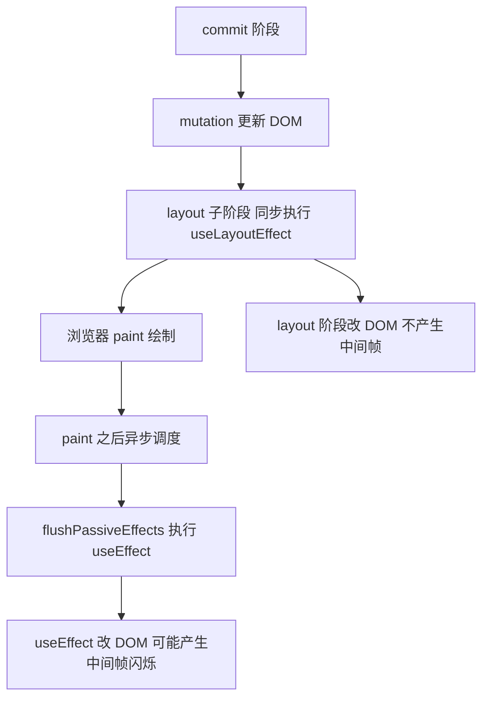

## FRP-082：useLayoutEffect 与 useEffect 在 paint 时序上的差别是什么？如何用它修复闪烁？

**答**：
- **useLayoutEffect 在 commit 的 layout 子阶段同步执行**（DOM 已更新但浏览器尚未绘制）；useEffect 排入 passive 队列，等 **paint 之后**由调度器异步执行。
- 浏览器流程：DOM mutation → layout 阶段（useLayoutEffect）→ **浏览器 paint 绘制** → 空闲后（微任务/调度）→ passive effects（useEffect）。
- 闪烁根因与修复：若"先 paint 再在 useEffect 里改 DOM"（如测量后设置宽度），用户会看到**两帧不同的画面**（闪一下）；useLayoutEffect 里改 DOM 会**阻塞 paint**——绘制发生在这段同步代码之后，用户只见最终状态。
- 代价：layout 阶段是同步阻塞的，重计算会卡绘制；默认优先 useEffect，只在"需要测量 DOM 并同步修改"时用 useLayoutEffect。SSR 下 useLayoutEffect 会警告（服务端不执行，改用 useEffect）。



```javascript
// 简化实现，帮助理解 paint 时序差异（模拟 commit 流水线）
function commitRoot(fiber) {
  const timeline = [];
  // 1. mutation：真实 DOM 更新
  timeline.push('DOM updated');
  // 2. layout：同步执行 useLayoutEffect，阻塞在此
  fiber.layoutEffects.forEach((eff) => {
    eff.destroy?.();
    eff.destroy = eff.create() || null;
    timeline.push('layoutEffect ran (before paint)');
  });
  // 3. paint：浏览器绘制（这里只是一个标记点）
  timeline.push('=== paint ===');
  // 4. passive：调度到 paint 之后（模拟为异步微任务）
  Promise.resolve().then(() => {
    fiber.passiveEffects.forEach((eff) => {
      eff.destroy?.();
      eff.destroy = eff.create() || null;
      timeline.push('passiveEffect ran (after paint)');
    });
    console.log(timeline.join('\n'));
  });
}

// 场景：测量 tooltip 高度并调整位置
const useTooltipFix = () => ({
  layoutEffects: [{
    create: () => {
      // 在 paint 前完成测量+修改 -> 用户只看到正确位置，无闪烁
      console.log('measure & reposition synchronously');
    },
  }],
  passiveEffects: [{
    create: () => {
      // 若逻辑写在这里：先绘制错误位置 -> 再修正 -> 两帧画面 -> 闪烁
      console.log('measure & reposition after paint (flicker!)');
    },
  }],
});

const { layoutEffects, passiveEffects } = useTooltipFix();
commitRoot({ layoutEffects, passiveEffects });
// 输出顺序：DOM updated -> layoutEffect -> paint -> passiveEffect
```
