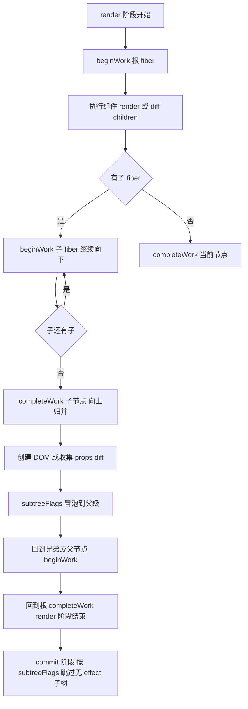

## FRP-087：beginWork 与 completeWork 的职责是如何划分的？为什么一个"向下"一个"向上"？

**答**：
- **beginWork（向下递归）**：处理当前 fiber 的"自上而下"信息——根据 lane 判断是否复用（bailout）、执行函数组件 renderWithHooks / 类组件实例 render、diff children（reconcileChildFibers）生成**子 fiber**（带 effectTag/flags），返回值是"下一个要处理的节点"（子优先，无子转 complete）。
- **completeWork（向上归并）**：子处理完后收尾——为宿主组件**创建/准备真实 DOM 实例**（首次挂载 createInstance），收集 props（与旧 props diff 标记 update 标记位），把**子树的 flags 冒泡**到父 fiber（`completeWork` 里 `subtreeFlags |= child.subtreeFlags`），使 commit 阶段能跳过无 effect 的子树。
- 首次挂载时 completeWork 阶段**不建 DOM 关系**（不 appendChild，防止树未完成时被 paint），只在 flags 上标记 Placement，DOM 树组装留给 commit 的 mutation 阶段。
- 整个 render 阶段 = workLoopSync/Concurrent 里反复执行 `performUnitOfWork`：beginWork 深入、completeWork 回溯，形成深度优先遍历。



```javascript
// 简化实现，帮助理解 beginWork 与 completeWork 的深度优先骨架
function performUnitOfWork(fiber) {
  // ===== beginWork：向下，产出子 fiber =====
  if (fiber.type === 'HostComponent') {
    // 宿主组件：diff 子元素，生成子 fiber 链（简化为直接创建）
    fiber.child = fiber.props.children
      ? { type: 'text', props: { content: fiber.props.children }, child: null, return: fiber, flags: 'Placement' }
      : null;
  } else {
    // 函数组件：执行 render 拿到元素描述，再转 fiber
    const children = fiber.type(fiber.props);
    fiber.child = { type: 'HostComponent', props: children, child: null, return: fiber, flags: 'Placement' };
  }
  // 返回下一个工作单元：子优先，其次兄弟，否则交由 completeWork 回溯
  if (fiber.child) return fiber.child;
  return completeUnitOfWork(fiber);
}

function completeUnitOfWork(fiber) {
  // ===== completeWork：向上，创建 DOM 并冒泡 flags =====
  while (fiber) {
    if (fiber.type === 'HostComponent' && !fiber.stateNode) {
      fiber.stateNode = document.createElement('div'); // DOM 实例在这里创建
      fiber.stateNode.textContent = fiber.props.children || '';
      fiber.stateNode.__flags = fiber.flags;            // props diff 标记位记录
    }
    // 子树 flags 冒泡：commit 阶段靠它跳过无 effect 的整棵子树
    fiber.return.subtreeFlags |= fiber.flags | (fiber.subtreeFlags || 0);
    if (fiber.sibling) return fiber.sibling; // 有兄弟：从兄弟继续 beginWork
    fiber = fiber.return;                    // 没兄弟：回到父节点继续 complete
  }
  return null; // 回到根，render 阶段结束
}

// 用法：App -> div -> text
const rootFiber = {
  type: function App() { return { type: 'div', children: 'hello' }; },
  props: {}, child: null, return: { subtreeFlags: 0, type: null },
  flags: 'Placement', subtreeFlags: 0,
};
let uow = rootFiber;
while (uow) uow = performUnitOfWork(uow); // 循环直到 render 完成
console.log(rootFiber.child.stateNode.textContent); // hello：DOM 已就绪待 commit
```
