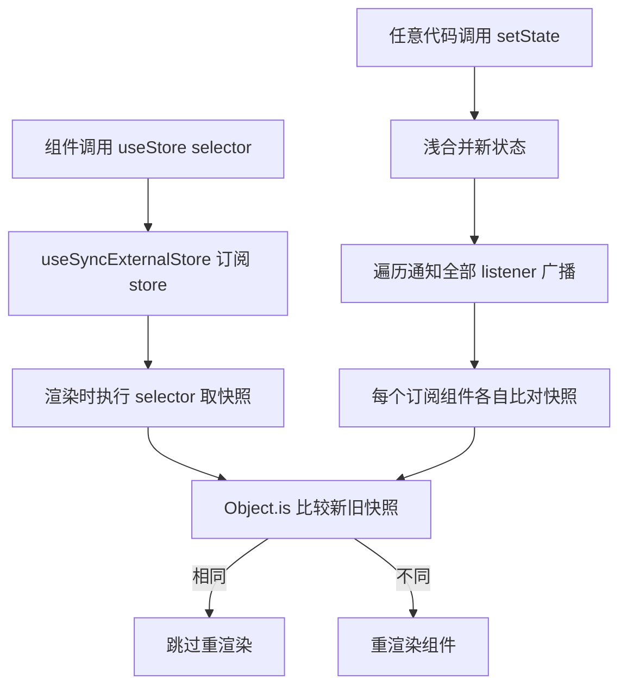

## FRP-095：Zustand 的核心实现是怎样的？create 后的状态如何做到精准订阅更新？

**答**：
- 核心 = 一个模块级 **store**（`{ getState, setState, subscribe, destroy }`）+ `useStore` Hook（内部是 **useSyncExternalStore**）。setState 时浅合并并通知所有 listener；subscribe 注册 listener。
- 精准订阅来自**两处浅比较**：① selector 让组件只订阅它关心的切片（`useStore(s => s.count)`）；② 比较函数默认 `Object.is`，可传 `shallow` 做一层浅比较——快照不变就**不触发重渲染**。
- 每个组件的 useSyncExternalStore 有独立的 handleStoreChange：store 通知是**广播**，但各组件各自比对自己的快照，只有快照引用变化的才重渲染——这就是 Zustand 不需要 Provider、也不会"一改全更"的原理。
- vanilla 版（`createStore`）完全脱离 React 可用，React 绑定只是薄薄一层 Hook。



```javascript
// 简化实现，帮助理解 Zustand 的 store 与 selector 浅比较
function createStore(createState) {
  let state;
  const listeners = new Set();
  const setState = (partial, replace) => {
    const nextState = typeof partial === 'function' ? partial(state) : partial;
    if (!Object.is(nextState, state)) {
      state = replace ? nextState : { ...state, ...nextState }; // 浅合并
      listeners.forEach((l) => l()); // 广播，是否重渲染由订阅方比对快照决定
    }
  };
  const store = {
    setState,
    getState: () => state,
    subscribe: (l) => { listeners.add(l); return () => listeners.delete(l); },
  };
  state = createState(setState, () => state);
  return store;
}

const shallow = (a, b) => {
  if (Object.is(a, b)) return true;
  if (typeof a !== 'object' || typeof b !== 'object' || !a || !b) return false;
  const ka = Object.keys(a), kb = Object.keys(b);
  return ka.length === kb.length && ka.every((k) => Object.is(a[k], b[k]));
};

function create(createState) {
  const store = createStore(createState);
  function useStore(selector, equalityFn = Object.is) {
    // 真实实现：useSyncExternalStoreWithSelector（快照 + memoized selector）
    let lastSnapshot = selector(store.getState());
    const check = () => {
      const next = selector(store.getState());
      if (!equalityFn(next, lastSnapshot)) {
        lastSnapshot = next;
        rerender(); // 只有自己关心的切片变了才重渲染
      }
    };
    store.subscribe(check); // mount 时订阅（真实实现交给 useSyncExternalStore）
    return lastSnapshot;
  }
  useStore.getState = store.getState;
  useStore.setState = store.setState;
  useStore.subscribe = store.subscribe;
  return useStore;
}
let rerender = () => {};

// 用法：两个组件订阅不同切片
const useBearStore = create((set) => ({
  count: 0, name: 'bear',
  inc: () => set((s) => ({ count: s.count + 1 })),
}));

rerender = () => console.log('CountView re-render');
console.log(useBearStore((s) => s.count)); // 0
useBearStore.setState({ name: 'panda' });  // count 未变：不重渲染
useBearStore.setState((s) => ({ count: s.count + 1 })); // count 变：重渲染
// 对比：不加 selector 时任何 state 变化都重渲染 —— selector 即订阅粒度
```
