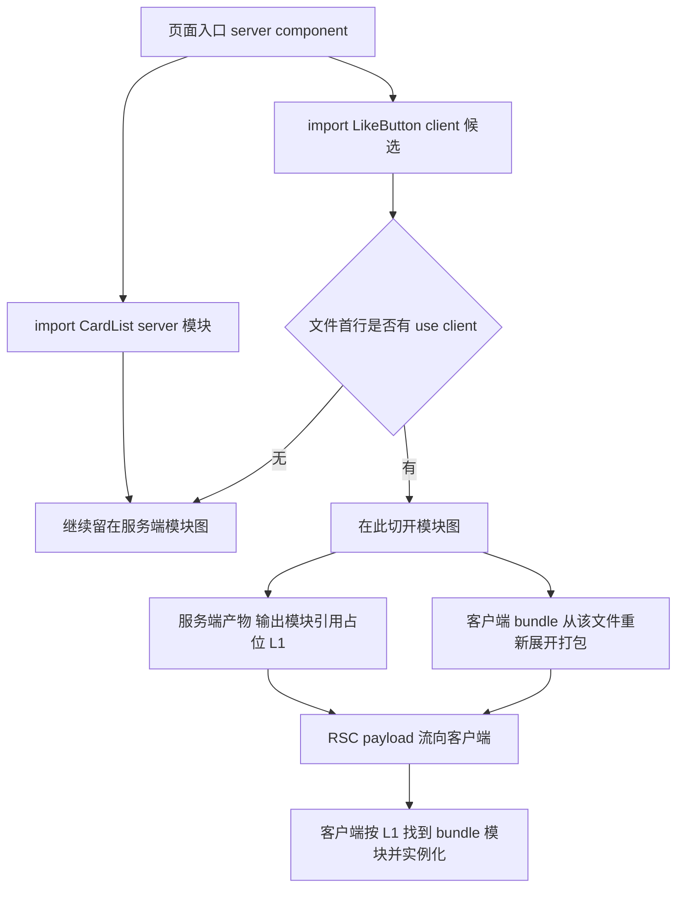

## FRP-141："use client" 指令的编译切片行为是怎样的？

**答**：
- "use client" 标记的是**模块图切片边界**：从该文件开始的 import 子图被切到客户端模块图；服务端引用它的地方只剩一个 client reference（id 占位）。
- 双向打包：server graph 里它变成 `{ $$id, $$async }` 引用对象（渲染时输出 `$Lid`）；client graph 从它重新展开打包出真正的 JS。
- 边界内的组件自动获得"客户端能力"（state/effect/事件），但同时失去了服务端能力（不能 import server-only 模块，不能 async 渲染取数）。
- 切片是**模块级**的：一个文件打上标记，整个文件的导出都成为 client 引用——所以边界要尽量下沉（把"use client"写在叶子交互组件上）。



```javascript
// 简化实现，帮助理解 client reference 的生成与还原
// —— 服务端打包器视角 ——
function processImport(mod, graph) {
  if (hasDirective(mod, 'use client')) {
    // 生成引用对象：不再深入它的 import 子图
    return {
      $$typeof: Symbol.for('react.client.reference'),
      $$id: getModuleId(mod),          // 模块在客户端 bundle 里的定位 id
      $$async: mod.isAsync,
    };
  }
  graph.add(mod);                      // server 模块：继续沿 import 展开
  mod.imports.forEach(m => processImport(m, graph));
}

// —— 服务端渲染时 ——
function renderClientReference(ref, props) {
  return `["$L${ref.$$id}", ${serialize(props)}]`; // payload 里的占位
}

// —— 客户端 hydrate 时 ——
const clientModules = { '1': LikeButtonModule };     // bundle 里的模块表
function resolveClientReference(id) {
  const mod = clientModules[id];
  return mod.default;                                 // 拿回真正的组件函数
}
// payload 流到 ["$L1", {postId: 9}] 时：
// resolveClientReference(1) -> LikeButton -> 用 props 正常渲染/交互

// 常见误区：
// "use client" 不是"这个文件在客户端运行"，而是"这是客户端模块图的最顶层入口"；
// 它的 import 的组件也全部是 client —— 边界粒度是子图，不是单个文件。
```
