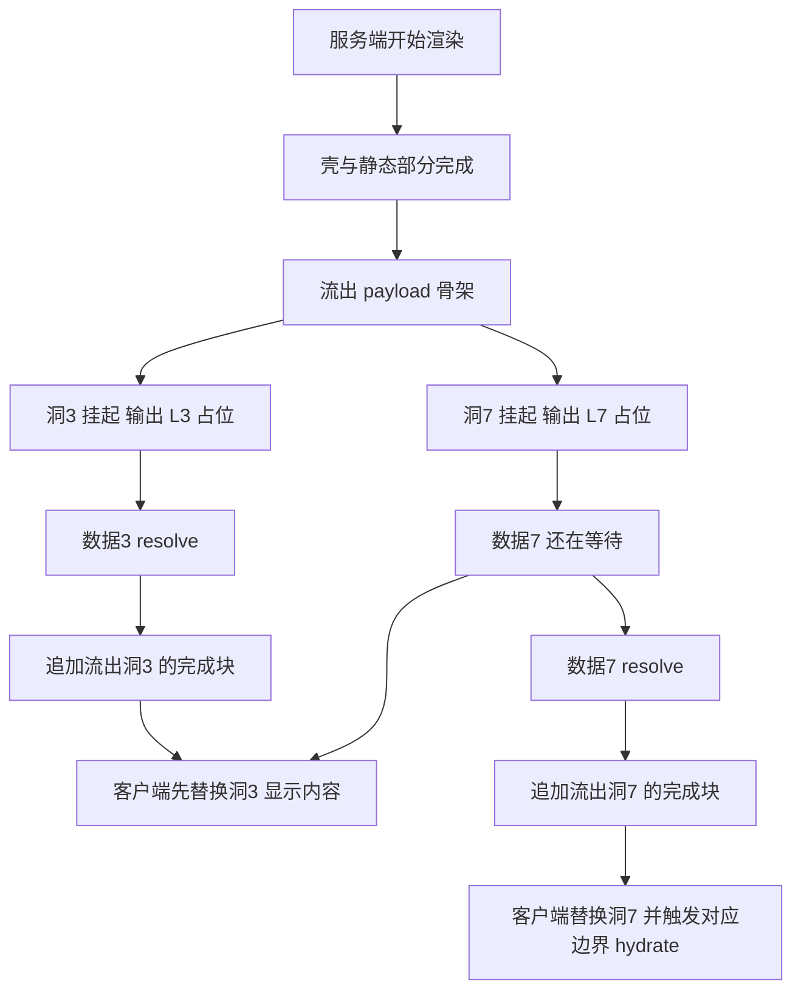

## FRP-144：RSC 的流式传输与 Suspense 洞是如何交互的？

**答**：
- 服务端把组件树切成"已完成的块"与"挂起的洞"：先流出壳（含 `$Lid` 占位），每个洞的 promise resolve 后**追加**流出该洞的完整块（块按 id 关联）。
- 客户端按 id 把流到的块**替换**进对应占位位置——不需要重新请求整棵树，也不需要刷新。
- 洞的边界对应 Suspense：resolve 前客户端显示 fallback，替换时机由 React 协调（有过渡动画时延迟切换，避免闪烁）。
- HTML 与 RSC payload 双流：初次访问是 HTML 流（含内嵌的 payload script 标签），客户端导航是纯 payload 流。



```javascript
// 简化实现，帮助理解"洞"的流式输出与客户端替换
function createFlightStream(rootPromise) {
  const chunks = [];
  const holes = new Map(); // id -> promise

  function serialize(node, out) {
    if (node && node.__hole) {                    // 占位
      out.push(`["$L${node.id}", ${JSON.stringify(node.temporaryProps)}]`);
      node.promise.then(v => {                    // resolve 后追加完整块
        const done = [];
        serialize(v, done);
        out.push(`3:${done.join('')}`);           // chunk id 3 = 洞 id
        flushChunk(out);
      });
      return;
    }
    // ... 常规元素序列化 ...
  }

  return new ReadableStream({
    async start(controller) {
      serialize(await rootPromise, chunks);
      controller.enqueue(chunks.join(''));
    }
  });
}

// —— 客户端：按 id 替换 ——
function applyRscPatch(chunkId, completedNode) {
  const placeholder = pendingHoles.get(chunkId);
  React.startTransition(() => {          // 过渡：避免 fallback 与内容闪烁切换
    pendingHoles.delete(chunkId);
    placeholder.resolve(completedNode);  // Suspense 洞重新渲染出真实内容
  });
}

// 网络时序示意：
// t0  流出: 0:["$",["div",["$L3","$L7"]]]      壳 + 两个洞
// t1  流出: 3:["h2",["Post A"]]                洞3 先好
// t2  流出: 7:["ul",["li","Comment..."]]       洞7 后好
// 客户端每个时刻都能立即渲染已收到的部分 —— TTFFP 首块时间大幅提前
```
