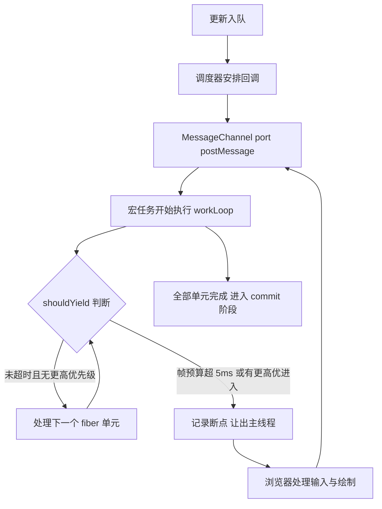

## FRP-148：Scheduler 为什么用 MessageChannel 实现时间切片，而不是 setTimeout？（高频）

**答**：
- 调度器需要"**宏任务级**的让出"：微任务（Promise.then）会在当前帧绘制前一口气跑完，无法被打断，等于不切片；而 rAF 的执行时机在绘制前，不适合做"下一帧继续干活"的调度。
- `setTimeout(fn, 0)` 有两个问题：**嵌套 5 层后最小间隔被钳到 4ms**（HTML 规范），高频切片时延迟显著；且某些场景（后台 tab）被大幅节流。
- MessageChannel 的 postMessage 触发的宏任务**无最小延迟**、不被 4ms 规则约束，是主线程上"尽快的宏任务"。
- 工作循环：每个宏任务里跑 workLoop，`shouldYield()` 检查已用时间是否超过帧预算（约 5ms）——超了就保存断点、让出主线程，排下一个宏任务继续。



```javascript
// 简化实现，帮助理解 MessageChannel 调度与时间切片
const channel = new MessageChannel();
const port = channel.port2;
let scheduledHostCallback = null;
const frameInterval = 5; // 帧预算：约 5ms

channel.port1.onmessage = () => {
  const cb = scheduledHostCallback;
  scheduledHostCallback = null;
  if (cb) cb(); // 宏任务：开始/继续工作循环
};

function scheduleCallback(callback) {
  scheduledHostCallback = callback;
  port.postMessage(null); // 比 setTimeout(0) 更快：无 4ms 钳制
}

function shouldYield() {
  return getTime() >= frameDeadline; // 超过帧预算 -> 让出
}
let frameDeadline = 0;
const getTime = () => performance.now();

// 工作循环：可中断
function workLoopConcurrent(units) {
  frameDeadline = getTime() + frameInterval;
  let i = 0;
  while (i < units.length) {
    if (shouldYield()) {
      // 时间到：保存进度，让出 —— 下一个宏任务从这里继续
      scheduleCallback(() => workLoopConcurrent(units.slice(i)));
      return 'yielded';
    }
    performUnit(units[i++]); // 处理一个 fiber 单元
  }
  return 'completed';
}

// 验证切片：10 万个单元不会卡死输入
const units = Array.from({ length: 100000 }, (_, i) => () => i);
scheduleCallback(() => workLoopConcurrent(units));
// 主线程每 ~5ms 让出一次，浏览器始终能响应输入与绘制
```
