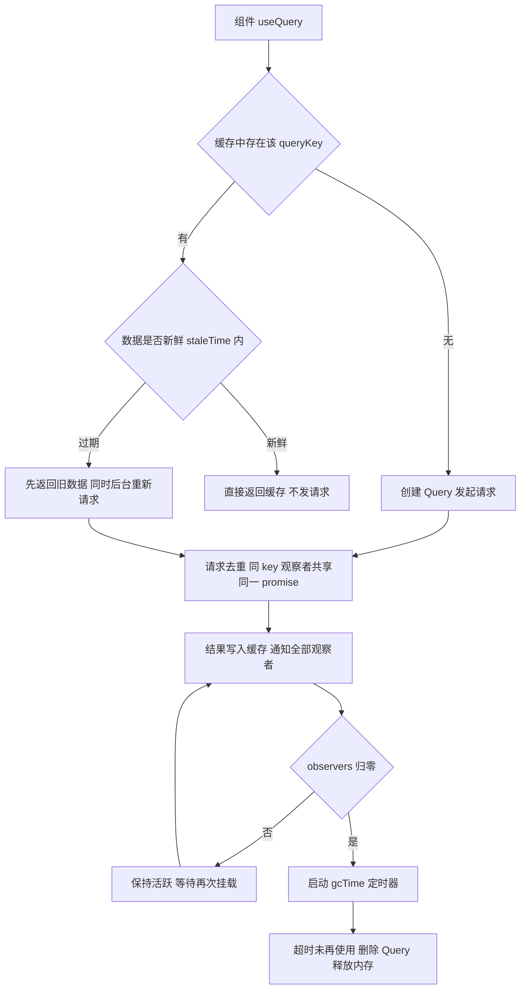

## FRP-161：TanStack Query 的核心原理是什么（缓存、去重、GC 的协作）？（高频）

**答**：
- 内核是 `QueryCache: Map<queryHash, Query>`；queryHash 由 queryKey 序列化生成——**key 相同即同一个 Query**。
- 去重：fetch 时所有同 key 的观察者共享**同一个 promise**（Query 内部挂 promise），并发调用 useQuery 只发一次请求。
- 生命周期由**观察者引用计数**驱动：`observers > 0` 活跃；归零后启动 `gcTime`（默认 5 分钟）定时器，超时整个 Query 从缓存删除——这就是"缓存垃圾回收"。
- `staleTime`（默认 0）决定新鲜期：新鲜期内挂载/重挂载直接用缓存不请求；过期则"先返回旧数据 + 后台重新请求"（stale-while-revalidate 语义）。



```javascript
// 简化实现，帮助理解 TanStack Query 内核
class Query {
  constructor({ queryKey, queryFn, staleTime = 0, gcTime = 5 * 60 * 1000 }) {
    this.hash = stableSerialize(queryKey);   // key 序列化（顺序无关）
    this.queryFn = queryFn;
    this.staleTime = staleTime;
    this.gcTime = gcTime;
    this.state = { data: undefined, dataUpdatedAt: 0, error: null };
    this.observers = 0;
    this.promise = null;                     // 去重的关键：共享 promise
    this.gcTimer = null;
  }
  get isStale() {
    return Date.now() - this.state.dataUpdatedAt > this.staleTime;
  }
  fetch() {
    // 去重：已有进行中的请求直接复用同一个 promise
    if (!this.promise) {
      this.promise = this.queryFn()
        .then(data => {
          this.state = { data, dataUpdatedAt: Date.now(), error: null };
          this.notify();                     // 通知全部观察者
        })
        .catch(e => { this.state.error = e; this.notify(); })
        .finally(() => { this.promise = null; });
    }
    return this.promise;
  }
  addObserver() {
    this.observers++;
    clearTimeout(this.gcTimer);              // 有观察者：取消 GC
    if (this.state.dataUpdatedAt && !this.isStale) return; // 新鲜：不发请求
    this.fetch();                            // 过期/无数据：请求（内部自动去重）
  }
  removeObserver() {
    if (--this.observers > 0) return;
    this.gcTimer = setTimeout(() => cache.delete(this.hash), this.gcTime); // GC 定时器
  }
  notify() { this.subscribers.forEach(fn => fn(this.state)); }
}

const cache = new Map(); // queryHash -> Query
function useQuery(options) {
  const query = cache.get(stableSerialize(options.queryKey)) ??
                setCache(new Query(options));
  query.addObserver();                       // 挂载
  useEffect(() => () => query.removeObserver(), []); // 卸载
  return { data: query.state.data, isPending: !query.promise && !query.state.dataUpdatedAt };
}
```
