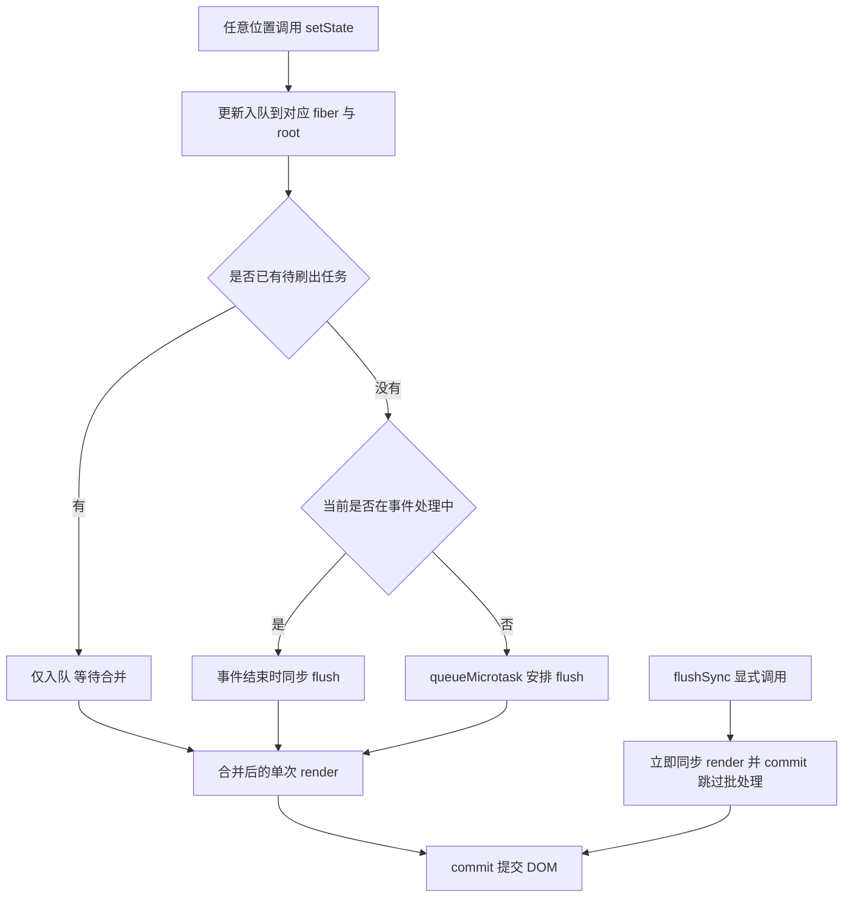

## FRP-168：automatic batching 的"微任务刷出"时机是如何实现的？（高频）

**答**：
- React18 起任何上下文的多次 setState 都合并：更新入队后，如果**当前没有待刷任务**，就 `queueMicrotask` 安排一次 flush；已有任务则只入队——合并由此而来。
- 事件上下文特殊：React 在事件处理**结束时**同步 flush（比微任务更早），这是离散事件即时响应的保障；await 之后、setTimeout、promise 回调里走微任务。
- `flushSync(fn)` 跳过批处理：立即同步执行 fn 内的更新并强制 commit，用它能解决"读更新后 DOM"的时序问题（代价是打断批处理）。
- 可预期性：批处理保证"多次 setState 一次 render"，但**不保证同步可见**——读取更新后的 DOM 要用 flushSync 或 useEffect。



```javascript
// 简化实现，帮助理解微任务刷出
const updateQueue = [];
let isFlushScheduled = false;

function setState(fiber, action) {
  updateQueue.push({ fiber, action });       // 1. 入队
  scheduleFlush();                            // 2. 安排刷出
}

function scheduleFlush() {
  if (isFlushScheduled) return;               // 已有待刷任务：合并
  isFlushScheduled = true;
  if (isInsideEventHandler) return;           // 事件上下文：等事件结束同步 flush
  queueMicrotask(flushWork);                  // 非事件上下文：微任务刷出
}

function flushWork() {
  isFlushScheduled = false;
  const actions = [...updateQueue]; updateQueue.length = 0;
  renderAndCommit(actions);                   // 3. 合并为一次 render + commit
}

// —— 事件包装：事件结束同步 flush ——
function dispatchEvent(e) {
  isInsideEventHandler = true;
  try {
    processHandler(e);       // 里面的多次 setState 只入队
  } finally {
    isInsideEventHandler = false;
    flushWork();             // 事件结束：立即刷出（比微任务还早）
  }
}

// 行为对照
setTimeout(() => {
  setA(1); setB(2);           // React18：批量！一次 render（React17 会两次）
  console.log(dom.textContent); // 旧值 —— 微任务还没跑
}, 0);
async function load() {
  await api();
  setLoading(true);           // await 之后：同样批量（React17 不会）
  setData(r);                 // 与上一行合并为一次 render
}
flushSync(() => { setA(1); setB(2); });
console.log(dom.textContent);  // 新值 —— flushSync 强制同步 commit
```
