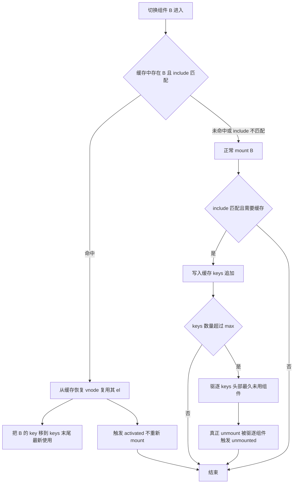

## FRP-179：手写 keep-alive：LRU + include 正则匹配如何落地？

**答**：
- keep-alive 的完整职责：缓存子组件 vnode（不渲染容器）、LRU 控制 max、include/exclude 按组件 **name** 决定缓存谁、驱逐时真正 unmount。
- 与 FRP-015 的差异点：这里给出**组件形态的完整实现**——include/exclude 支持正则与数组、命中缓存时替换 vnode 并标记 `keepAlive` 让渲染器跳过 remount、失活走 deactivated。
- 渲染器配合：patch 时检测 `vnode.shapeFlag & COMPONENT_SHOULD_KEEP_ALIVE`，命中缓存的组件直接复用缓存 vnode 的 el，不重新 mount。



```javascript
// 简化实现，帮助理解 keep-alive（LRU + include 正则匹配）
const KeepAlive = {
  __isKeepAlive: true,
  props: { include: [RegExp, Array, String], exclude: [RegExp, Array, String], max: Number },
  setup(props, { slots }) {
    const cache = new Map();     // key -> { vnode, type }
    const keys = new Set();      // LRU 顺序：尾部最新

    function matches(pattern, name) {
      if (!pattern) return true;
      if (Array.isArray(pattern)) return pattern.includes(name);
      if (typeof pattern === 'string') return new RegExp(pattern).test(name);
      return pattern.test(name);   // RegExp
    }
    function shouldCache(name) {
      return matches(props.include, name) && !matches(props.exclude, name);
    }

    // 渲染器注入的两个钩子：缓存复用 / 真实卸载
    const { cacheSubtree, unmountCached } = injectKeepAliveHooks();
    cacheSubtree((vnode, raw) => {
      const key = raw.key ?? raw.type;
      const name = raw.type.name ?? '';
      if (!shouldCache(name)) return;              // include 不匹配：不缓存
      if (cache.has(key)) {
        // 命中：LRU 更新顺序，替换 vnode 引用
        const cached = cache.get(key);
        raw.el = cached.vnode.el;                  // 复用已挂载的 DOM！
        raw.component = cached.vnode.component;
        keys.delete(key); keys.add(key);
        raw.component.activated?.();               // 触发 activated
      } else {
        cache.set(key, { vnode: raw });
        keys.add(key);
        if (props.max && keys.size > props.max) {
          // 驱逐最久未用（Set 头部）
          const evicted = keys.values().next().value;
          keys.delete(evicted);
          const stale = cache.get(evicted);
          cache.delete(evicted);
          unmountCached(stale.vnode);              // 真正 unmount -> unmounted
        }
      }
    });

    onBeforeUnmount(() => { cache.forEach(c => unmountCached(c.vnode)); });

    return () => {
      const raw = slots.default()[0];              // 只处理单子节点
      // 标记：让渲染器知道这是被 keep-alive 管理的组件
      raw.shapeFlag |= ShapeFlags.COMPONENT_SHOULD_KEEP_ALIVE;
      return raw;
    };
  }
};
// 渲染器侧配合（patch 时）：命中 keep-alive 的组件 vnode 已有 component/el —— 跳过 mountComponent
// 用法：<KeepAlive include="Home,Detail" :max="5"><component :is="view" /></KeepAlive>
```
