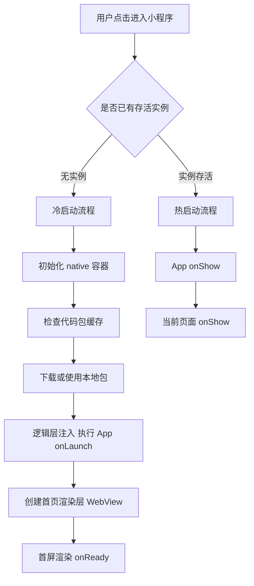

## MP-008：小程序启动流程全解？冷启动与热启动的差异？
**答**：
- **冷启动**：用户首次打开或小程序被销毁后打开 → native 初始化 → 检查/下载代码包（命中缓存则本地加载）→ 逻辑层注入并执行 App.onLaunch → 创建首页渲染层 WebView → 首屏渲染完成。
- **热启动**：小程序切后台后未被销毁，再次打开时**不再重新初始化**，直接触发 App.onShow 与页面 onShow，速度极快。
- **销毁时机**：后台停留超过约 5 分钟（各端不同）、连续收到系统内存告警、或用户主动杀进程。
- 启动优化围绕冷启动做：控制主包体积、lazyCodeLoading、启动阶段少做同步工作（详见 MP-037）。

```javascript
App({
  onLaunch() { /* 仅冷启动一次：登录、拉取全局配置 */ },
  onShow()   { /* 冷启动与热启动都会触发：刷新登录态、深链处理 */ },
  onHide()   { /* 切后台：埋点上报、暂停轮询 */ }
})
```



---

## 二、页面与路由（009-015）
