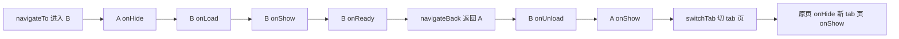

## MP-013：页面生命周期完整时序？与 TabBar 切换如何配合？
**答**：
- 首次进入：`App.onLaunch` → `App.onShow` → 页面 `onLoad`（仅一次，拿参数）→ `onShow` → `onReady`（仅一次，首渲完成，可操作节点）。
- 页面切换 A→B：A `onHide` → B `onLoad/onShow/onReady`；B 返回 A：B `onUnload` → A `onShow`。
- **TabBar 切换不触发 onLoad/onUnload**，只触发 onHide/onShow——所以 tab 页数据刷新逻辑放 onShow。
- onShow 是最常用的"回来刷新"钩子，但要防与 onLoad 重复请求（用标志位区分首次）。

```javascript
Page({
  onLoad(query)  { console.log('仅一次', query) ; this.firstShow = true },
  onShow() {
    if (this.firstShow) { this.firstShow = false; return } // onLoad 已拉取
    this.refresh()                                          // tab 切回/返回刷新
  },
  onReady()  { console.log('首渲完成，可 createSelectorQuery') },
  onHide()   { console.log('切走/切 tab/被覆盖') },
  onUnload() { console.log('销毁：清定时器、解绑全局事件') }
})
```


