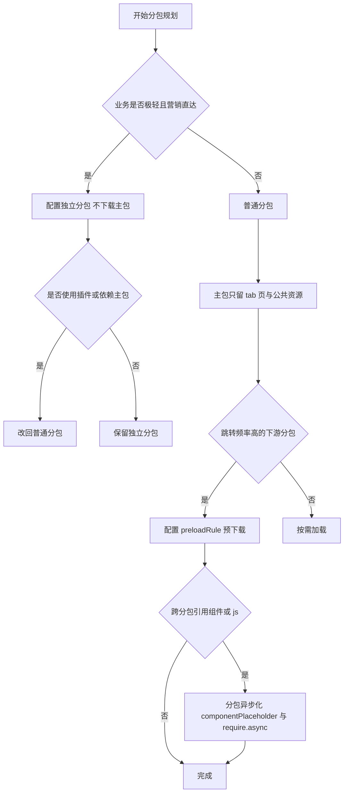

## MP-033：分包预下载 preloadRule 怎么配置？
**答**：
- 进入指定页面时，微信在后台**静默预下载**目标分包，跳转时零等待。
- 配置 `preloadRule`：key 为页面路径，`packages` 填分包 root 或 name，`network` 取 `all/wifi`。
- 限制：**同一个页面享有的预下载大小限额 2M**；预下载不影响主包加载优先级。
- 决策：把"当前页最可能跳转的下一站"配成预下载，如首页预下载核心业务分包。

```json
{
  "preloadRule": {
    "pages/index/index": { "network": "all",  "packages": ["packageA"] },
    "pages/mine/mine":   { "network": "wifi", "packages": ["shop"] }
  }
}
```


