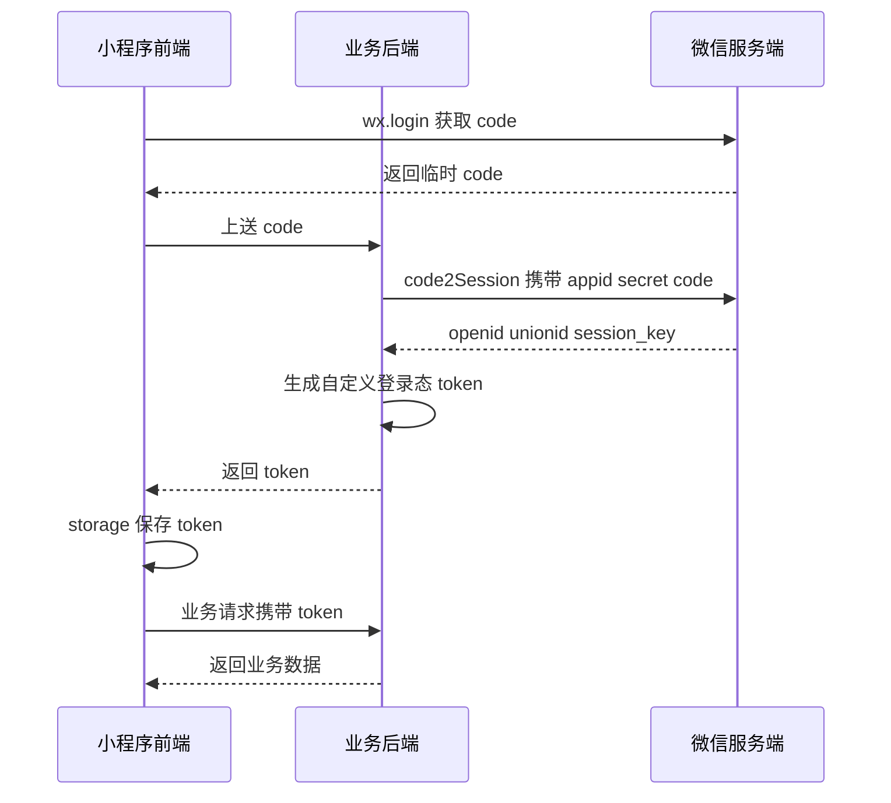

## MP-045：小程序登录鉴权的完整流程？（高频压轴）
**答**：
- 前端 `wx.login` 拿**临时凭证 code**（5 分钟有效、一次性）→ 传给自家后端。
- 后端携 appid + secret + code 调微信 `code2Session` 接口，换回 `openid / unionid / session_key`。
- 后端自签发**自定义登录态**（token/session）返回前端，前端 storage 保存，后续请求放 header。
- `session_key` 是数据解密密钥，**绝不能下发前端**；token 过期用 `wx.checkSession` 判断 session_key 是否仍有效来决定静默重登。

```javascript
// 前端登录封装
function login() {
  wx.login({
    success: ({ code }) => {
      wx.request({
        url: 'https://api.example.com/auth/login',
        method: 'POST',
        data: { code },
        success: (res) => {
          wx.setStorageSync('token', res.data.token)   // 自定义登录态
        }
      })
    }
  })
}
wx.checkSession({
  success: () => console.log('session 未过期，沿用登录态'),
  fail: login                                           // 过期则重新 wx.login
})
```


