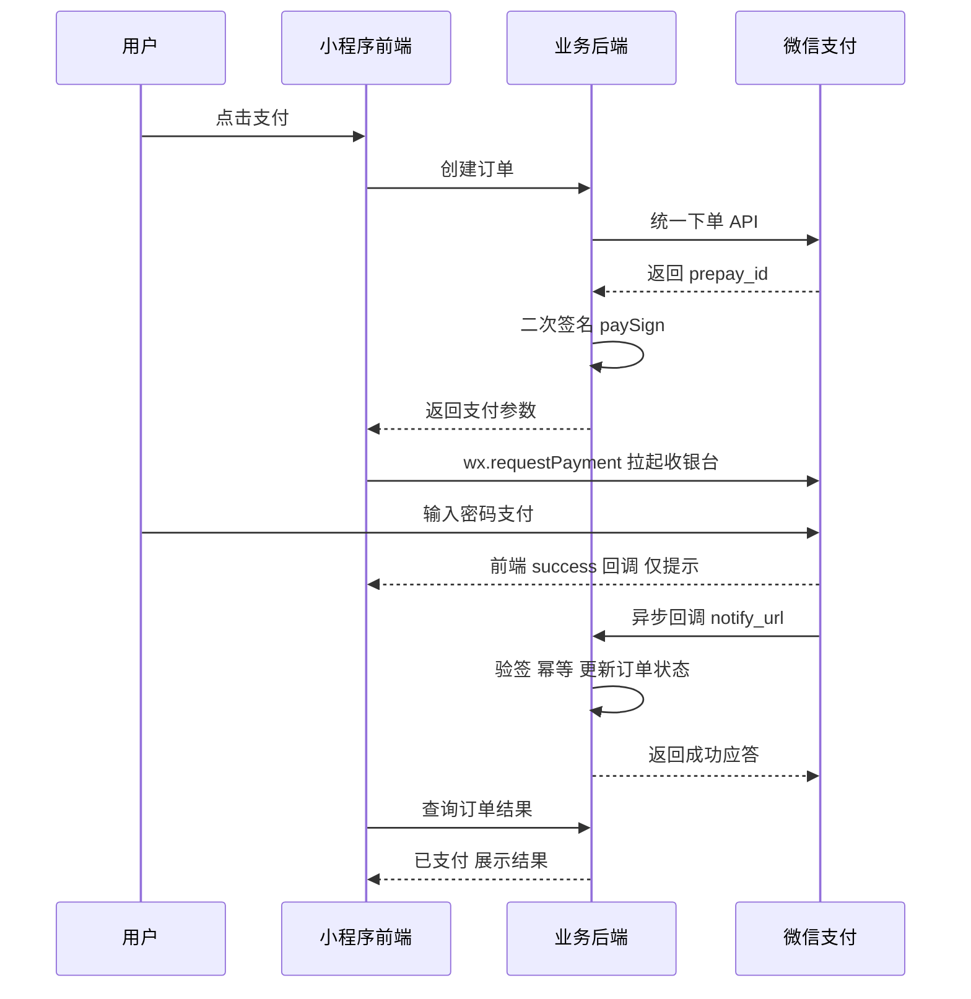

## MP-048：小程序支付的完整流程？（高频压轴）
**答**：
- ① 用户下单，前端调自家后端创建订单；② 后端调微信**统一下单 API**（含 openid、金额、notify_url）拿到 `prepay_id`；③ 后端按规则二次签名生成 `timeStamp/nonceStr/package/paySign` 返回前端；④ 前端 `wx.requestPayment` 拉起收银台；⑤ 用户支付后微信**异步回调 notify_url**，后端验签 + 幂等更新订单；⑥ 前端轮询/被回调通知后展示结果。
- 核心原则：**前端 success 不代表支付成功**，一切以后端回调与查单为准；金额计算必须在服务端。
- 回调处理要点：验签、按 out_trade_no 幂等、快速返回成功应答。

```javascript
// 前端：用后端返回的签名参数拉起收银台
wx.requestPayment({
  timeStamp: '1699999999',
  nonceStr: 'abc123def456',
  package: 'prepay_id=wx2012345678abcdef',
  signType: 'RSA',
  paySign: '后端返回的签名',
  success: () => this.pollOrderStatus(),   // 仅作提示，结果以后端为准
  fail: (e) => console.log('取消或失败', e.errMsg)
})
```


