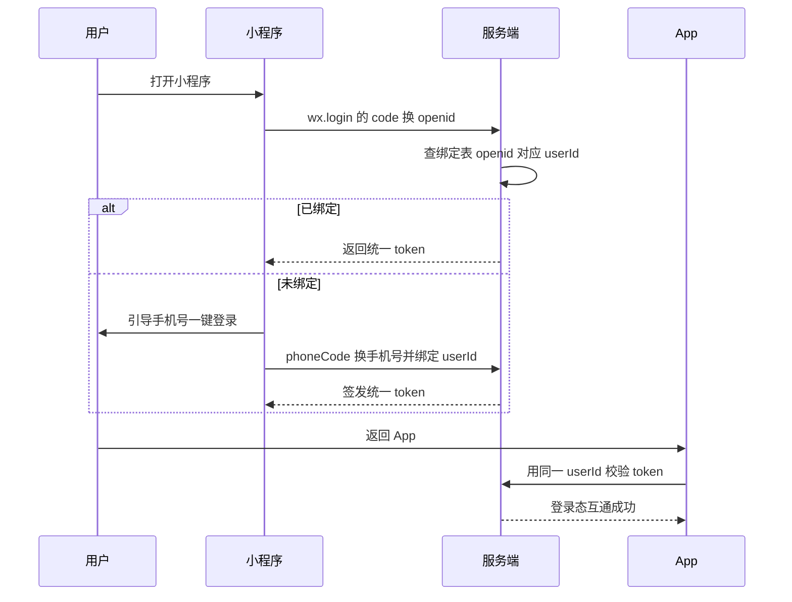

## MP-119：小程序与 App 的登录态如何打通？
**答**：
- 同一账号体系下，App 与小程序各自完成本平台鉴权（App：手机号/三方登录；小程序：wx.login），**服务端将两者关联到同一个 userId**，签发统一的自有 token。
- 关联方式：小程序端引导绑定（手机号一键登录 `getPhoneNumber`），或 App 拉起小程序时**经签名参数传递临时授权码**，服务端校验后绑定。
- token 过期共用同一刷新机制；openid/unionid 只是身份映射，**绝不能作为唯一鉴权依据**。
- 安全要点：跨端传递的参数要带时间戳+签名防重放；绑定关系落库（userId ↔ openid ↔ device）。

