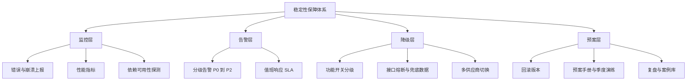

## MP-172：设计一个稳定性保障体系（监控/告警/降级/预案，压轴）？
**答**：
- **监控**：错误（onError/接口失败率/资源加载失败）、性能（启动/首渲）、资源（CDN 可用性），统一上报打版本/平台标签。
- **告警**：分级（P0 全站不可用/P1 核心链路劣化/P2 长尾问题），阈值 + 同比环比双触发，值班响应 SLA（P0 15 分钟）。
- **降级**：功能开关分级（全功能/只读/维护页），依赖接口熔断返回兜底数据，CDN/支付渠道多供应商切换。
- **预案**：预案手册（回滚版本/切配置/降级开关 各自的操作步骤与负责人），季度演练；复盘制度闭环。

