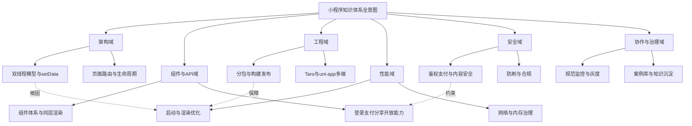

## MP-200：小程序知识体系收束（六域全景图）？
**答**：
- 六域：**架构**（双线程/通信/渲染）、**组件与 API**（组件体系/生命周期/开放能力）、**工程**（构建/分包/CI/多端）、**性能**（启动/渲染/网络/内存）、**安全**（鉴权/支付/内容/风控）、**协作与治理**（规范/监控/灰度/知识沉淀）。
- 收束主线：架构是因，性能与安全是果，工程与治理是把果守住的手段。
- 面试收官答法：任意一道小程序题都能映射回六域之一，并能指出它与相邻域的联动。

