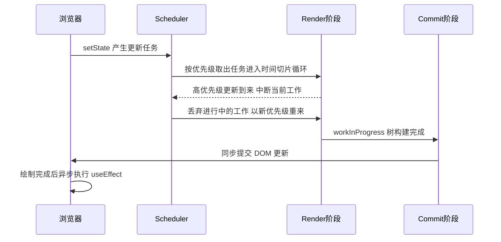

## R19-036：React Diff 算法的三条策略是什么？
**答**：
- 策略一：不同类型的元素产生不同的树，类型不同直接卸载旧树重建新树。
- 策略二：同层比较，DOM 节点跨层级移动会被视为删除加重建，所以不要随意改变节点层级。
- 策略三：同层同类型的多个子节点通过 key 标识身份，key 匹配则复用 Fiber 并只更新变化的 props。
- 基于这三条假设 Diff 复杂度从 O(n^3) 降到 O(n)。

```jsx
function DiffDemo({ isVip, items }) {
  // 类型不同：ul 与 div 之间切换会整棵重建
  // 同层同级：key 相同的 li 会被复用，只更新 props
  return isVip ? (
    <ul>
      {items.map((item) => (
        <li key={item.id}>{item.text}</li>
      ))}
    </ul>
  ) : (
    <div>
      {items.map((item) => (
        <span key={item.id}>{item.text}</span>
      ))}
    </div>
  );
}
```

---

## 第五章 并发渲染 Suspense 与错误边界（R19-037 ~ R19-043）



## 追问（补充）

**追问**：

1. 为什么跨层级移动会被当成删除加重建？ → diff 只在同一父节点的 children 范围内比较，没有跨层搜索机制（那会退化到 O(n³) 级别）；从 A 容器挪到 B 容器，在算法看来是两次互不相关的操作。
2. key 相同但组件类型不同，会复用吗？ → 不会。复用条件是 key 与 type 同时相等，类型变了就卸载旧的、按新类型创建，state 全部丢失，这就是三元里切换两个组件会重置状态的原因。
3. 三条策略只覆盖 render 阶段，commit 还要做什么？ → diff 产出 placement/update/deletion 标记，commit 分 beforeMutation、mutation（真正改 DOM）、layout 三段执行，layout 之后才异步跑 passive effect。
