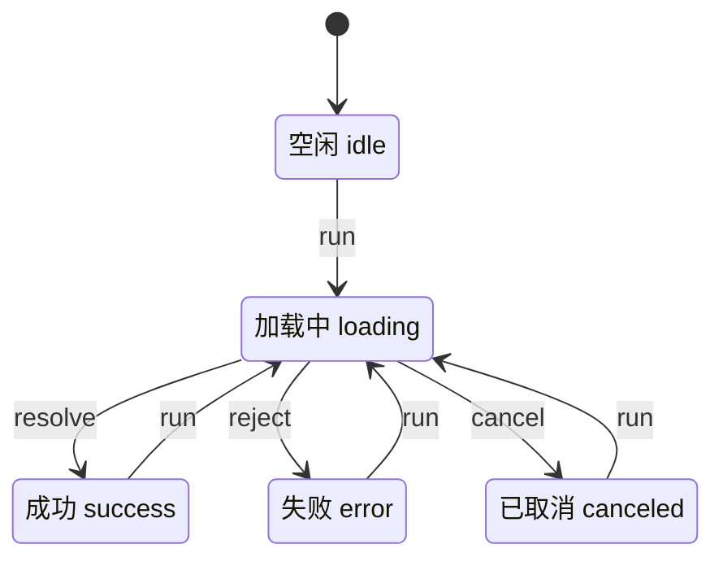

## R19-068：手写一个 ahooks 风格的 useRequest？
**答**：
- 核心状态：loading/data/error，配套 run（手动触发）、cancel（取消）、manual（是否自动执行）。
- 竞态用递增计数器解决：每次 run 计数 +1，只有"当前编号"的请求才能写入结果，过期响应直接丢弃。
- cancel 同时做两件事：AbortController 中断网络 + 计数 +1 让在途结果全部过期。
- 组件卸载时自动 cancel，防止内存泄漏式 setState。
- service 若随渲染重建，调用侧用 useMemoizedFn 包裹，避免非 manual 模式反复触发。



```jsx
// useRequest.ts —— loading / error / data / cancel / manual 全套
import { useCallback, useEffect, useRef, useState } from 'react';

export function useRequest(service, { manual = false, onSuccess, onError } = {}) {
  const [state, setState] = useState({ loading: false, data: undefined, error: undefined });
  const countRef = useRef(0);      // 竞态计数：只认最后一次请求
  const abortRef = useRef(null);

  const run = useCallback(async (...params) => {
    const current = ++countRef.current;
    abortRef.current?.abort();
    abortRef.current = new AbortController();
    setState(s => ({ ...s, loading: true, error: undefined }));
    try {
      const data = await service(...params, { signal: abortRef.current.signal });
      if (current !== countRef.current) return;    // 过期请求丢弃结果
      setState({ loading: false, data, error: undefined });
      onSuccess?.(data, params);
      return data;
    } catch (error) {
      if (current !== countRef.current || error.name === 'AbortError') return;
      setState({ loading: false, data: undefined, error });
      onError?.(error, params);
    }
  }, [service, onSuccess, onError]);

  const cancel = useCallback(() => {
    countRef.current++;                            // 让在途结果全部过期
    abortRef.current?.abort();
    setState(s => ({ ...s, loading: false }));
  }, []);

  useEffect(() => {
    if (!manual) run();
    return () => cancel();                         // 卸载自动取消
  }, [manual, run, cancel]);

  return { ...state, run, cancel, refresh: run };
}
```
