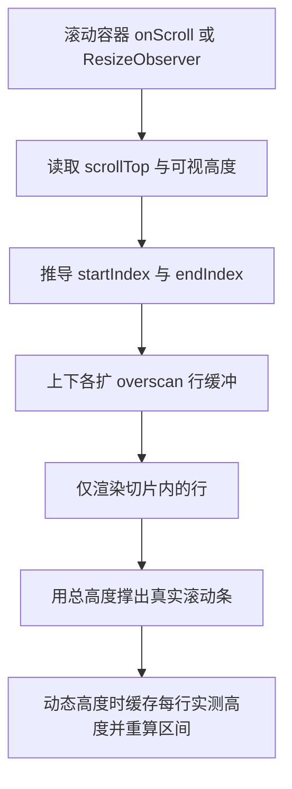

## R19-093：虚拟列表的完整实现？定高与动态高度的区别？
**答**：
- 核心：只渲染可视区切片（start ~ end，外加 overscan 缓冲），用总高度撑出真实滚动条，切片用绝对定位摆放。
- 定高：startIndex = floor(scrollTop / itemHeight)，O(1) 直接算。
- 动态高度：维护"index -> 实测高度"缓存，未测量的行用估算值；scrollTop 反查 startIndex 用累加或二分，测量回报后触发区间重算。
- overscan 上下各多渲染几行，快速滚动时不露白；总高度变化时滚动偏移可能抖动，需要修正。



```jsx
// useVirtualList.ts —— 定高 O(1)，动态高度走测量缓存
import { useCallback, useMemo, useRef, useState } from 'react';

export function useVirtualList({ count, itemHeight, overscan = 5 }) {
  const containerRef = useRef(null);
  const [range, setRange] = useState({ start: 0, end: 20 });
  const heightsRef = useRef([]);            // 动态高度缓存：index -> 实测高度

  const getOffset = useCallback((index) => {
    if (typeof itemHeight === 'number') return index * itemHeight;
    // 动态高度：未测量的行用估算值，已测量的行用真实值累加
    let offset = 0;
    for (let i = 0; i < index; i++) offset += heightsRef.current[i] ?? itemHeight;
    return offset;
  }, [itemHeight]);

  const onScroll = useCallback(() => {
    const el = containerRef.current;
    if (!el) return;
    const scrollTop = el.scrollTop;
    // 从 scrollTop 反查 startIndex（定高直接除，动态高度累加探测）
    let start = 0;
    if (typeof itemHeight === 'number') start = Math.floor(scrollTop / itemHeight);
    else while (start < count && getOffset(start + 1) < scrollTop) start++;

    let end = start;
    while (end < count && getOffset(end) < scrollTop + el.clientHeight) end++;
    setRange({ start: Math.max(0, start - overscan), end: Math.min(count, end + overscan) });
  }, [count, itemHeight, overscan, getOffset]);

  const totalHeight = useMemo(() => getOffset(count), [count, getOffset]);

  return {
    containerProps: { ref: containerRef, onScroll },
    range,                                   // 调用方只渲染 range 内的行
    totalHeight,
    getItemOffset: getOffset,
    measureItem: (index, height) => {        // 行渲染后回报真实高度
      if (heightsRef.current[index] !== height) {
        heightsRef.current[index] = height;
        onScroll();                          // 高度变化后重算区间
      }
    },
  };
}
```
