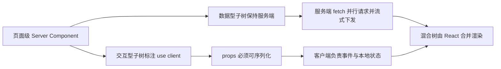

## R19-102：Server Component 的数据获取模式有哪些？
**答**：
- 服务端组件可以直接 async/await，数据请求不发到浏览器，凭据不出服务端。
- 互不依赖的请求必须 Promise.all 并行，否则串行瀑布让 TTFB 翻倍。
- 缓存策略逐请求声明：`next.revalidate` 走 ISR、`cache: 'no-store'` 走实时、`next.tags` 支持后续按标签失效。
- 依赖前序结果的请求（如先拿用户再拿其订单）无法并行，把两段拆成嵌套组件并各自 Suspense，缩小瀑布范围。



```tsx
// app/products/[id]/page.tsx —— 服务端组件：并行 fetch + 缓存策略逐请求声明
import { Suspense } from 'react';

// 三个请求互不依赖，Promise.all 并行，总耗时取最大值
async function getProductPageData(id: string) {
  const [product, reviews, recommendations] = await Promise.all([
    fetch(`${API}/products/${id}`, { next: { revalidate: 300 } }),       // 商品信息 5 分钟缓存
    fetch(`${API}/products/${id}/reviews`, { cache: 'no-store' }),       // 评价实时
    fetch(`${API}/recommend?for=${id}`, { next: { revalidate: 3600 } }), // 推荐内容 1 小时缓存
  ]);
  if (!product.ok) throw new Error('商品加载失败');
  return {
    product: await product.json(),
    reviews: await reviews.json(),
    recommendations: await recommendations.json(),
  };
}

export default async function ProductPage({ params }: { params: { id: string } }) {
  const { product, reviews, recommendations } = await getProductPageData(params.id);
  return (
    <>
      <ProductInfo data={product} />       {/* 纯展示，留在服务端 */}
      <Reviews list={reviews} />
      <AddToCart product={product} />      {/* 有交互，标 use client 的叶子组件 */}
    </>
  );
}
```
