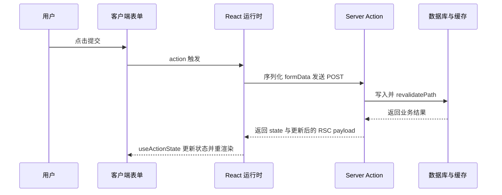

## R19-103：Server Actions 表单提交的完整链路是怎样的？
**答**：
- 全链路：客户端提交 -> React 序列化 formData 发送 POST 到当前路由 -> 服务端执行 Action（校验、写库）-> revalidatePath 失效缓存 -> 返回 state 与更新后的 RSC payload -> useActionState 更新 UI。
- useActionState 返回 `[state, formAction, isPending]`，state 即 Action 的返回值，天然承载校验错误。
- 校验失败返回错误 state、不刷新缓存；成功后 revalidatePath + redirect。
- Action 未完成时后续提交自动排队，无需自己写防重锁。



```tsx
// app/actions.ts —— 服务端
'use server';

import { revalidatePath } from 'next/cache';
import { redirect } from 'next/navigation';

export async function createPost(prevState, formData) {
  const title = String(formData.get('title') ?? '');
  if (title.trim().length < 2) {
    return { error: '标题至少 2 个字符' };     // 校验失败：返回 state，不触发缓存刷新
  }
  const post = await db.post.create({ data: { title } });
  revalidatePath('/posts');                    // 失效列表页缓存，下次访问重新渲染
  redirect(`/posts/${post.id}`);               // 成功后跳详情
}

// app/new-post/page.tsx —— 客户端
'use client';

import { useActionState } from 'react';

export function NewPostForm() {
  const [state, formAction, isPending] = useActionState(createPost, { error: null });
  return (
    <form action={formAction}>
      <input name="title" />
      {state.error && <p role="alert">{state.error}</p>}
      <button disabled={isPending}>{isPending ? '提交中' : '发布'}</button>
    </form>
  );
}
```
