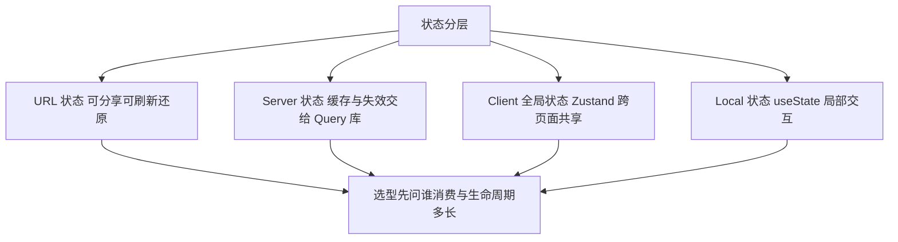

## R19-115：状态分层架构：server / client / url / local 四层怎么落？
**答**：
- URL 状态：可分享、可刷新还原的筛选分页（useSearchParams）。
- Server 状态：服务端数据的缓存与失效交给 TanStack Query/RTK Query，不要自己复制进 store。
- Client 全局状态：跨页面共享的客户端事实（主题、购物车）进 Zustand。
- Local 状态：仅本组件的交互细节用 useState/useReducer。
- 判定口诀：先问生命周期与消费范围，能 local 不 global，能 URL 不 store。



```jsx
// ProductListPage.jsx —— 四层状态各归其位
import { useState } from 'react';
import { useSearchParams } from 'react-router-dom';
import { useQuery } from '@tanstack/react-query';
import { useCartStore } from '@/store/cart';

function ProductListPage() {
  // 1. URL 状态：page / keyword —— 可分享、可刷新还原
  const [params, setParams] = useSearchParams();
  const keyword = params.get('q') ?? '';

  // 2. Server 状态：TanStack Query 持有，含缓存、重试、失效
  const { data } = useQuery({
    queryKey: ['products', keyword],
    queryFn: () => fetchProducts(keyword),
  });

  // 3. Client 全局状态：Zustand，跨页面共享（购物车角标）
  const cartCount = useCartStore(s => s.count);

  // 4. Local 状态：仅本组件的交互细节
  const [previewId, setPreviewId] = useState(null);

  return <> {/* 列表、购物车角标、预览弹窗 */} </>;
}
```
