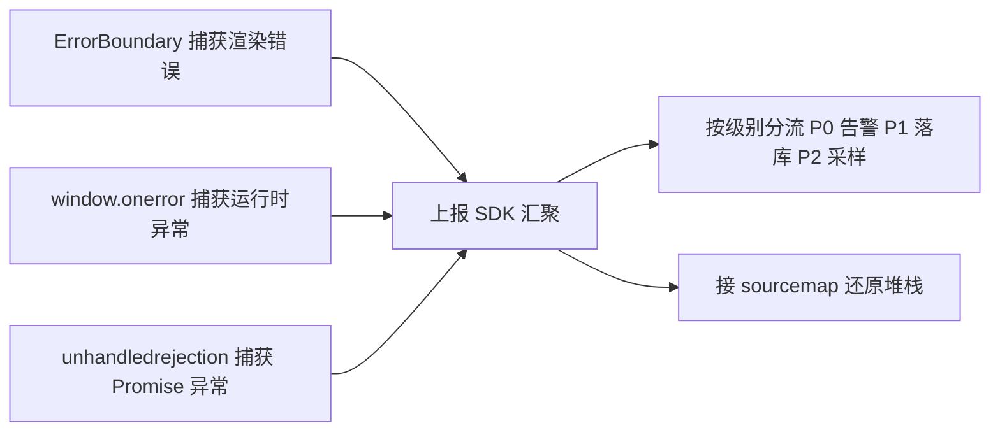

## R19-119：React 应用的错误监控体系怎么建？
**答**：
- 三层捕获：ErrorBoundary 兜渲染错误（带 componentStack）、window.onerror 兜全局运行时异常、unhandledrejection 兜 Promise 异常。
- 分级处理：P0 渲染崩溃全量上报 + 告警，P1 运行时异常全量落库，P2 警告类采样上报控制成本。
- 上报用 navigator.sendBeacon，页面卸载也不丢；生产环境接 sourcemap 还原堆栈。
- ErrorBoundary 只能捕获渲染期错误，事件回调与异步里的错误靠全局兜底。



```jsx
// monitor.ts —— 分级上报：渲染层边界 + 全局兜底 + 采样
import { ErrorBoundary } from './ErrorBoundary';

// 1. 渲染错误：ErrorBoundary 兜住并带上下文上报
export function RouteBoundary({ children }) {
  return (
    <ErrorBoundary
      onError={(error, componentStack) => report({
        level: 'error',
        type: 'react-render',
        message: error.message,
        stack: error.stack,
        componentStack,
      })}
    >
      {children}
    </ErrorBoundary>
  );
}

// 2. 全局兜底：window.onerror 与 unhandledrejection
window.addEventListener('error', e =>
  report({ level: 'error', type: 'runtime', message: e.message, stack: e.error?.stack }));
window.addEventListener('unhandledrejection', e =>
  report({ level: 'warn', type: 'promise', message: String(e.reason) }));

// 3. 上报策略：P0 全量 + 告警；P1 全量落库；P2 采样 10%，控制成本
function report(payload) {
  if (payload.level === 'warn' && Math.random() > 0.1) return;   // 警告采样
  navigator.sendBeacon('/api/monitor', JSON.stringify(payload)); // 卸载也能发出去
}
```
