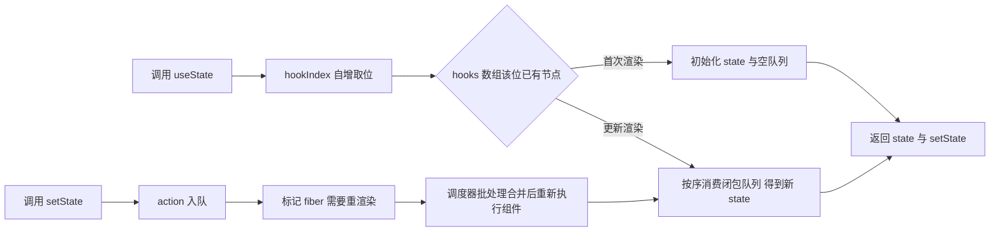

## R19-131：手写一个简化版 useState，说明 hooks 链与更新队列的工作原理？
**答**：
- 核心：hook 按**调用顺序**挂在 fiber 的 hooks 数组上（链表），每次渲染 cursor 归零，靠顺序对位——这就是"hooks 不能写在 if 里"的根源。
- setState 不直接改值，而是把 action **入队**；下次渲染时按序消费队列，函数式更新基于上一个结果累积。
- state 是渲染快照：事件回调里读到的永远是本次渲染闭包里的旧值。
- 多次 setState 会被批处理：一轮事件里只触发一次重渲染（React 18 起自动批处理覆盖所有场景）。



```jsx
// mini-react.js —— 手写 useState：hooks 链 + 闭包队列 + 批处理
let currentFiber = null;      // 当前正在渲染的组件实例
let hookIndex = 0;            // 渲染时的 hook 游标，按调用顺序对位
let isBatching = false;
const pendingFibers = new Set();

export function render(fiber) {
  currentFiber = fiber;
  hookIndex = 0;                        // 关键：每次渲染游标归零
  fiber.output = fiber.Component();     // 重新执行函数组件
  currentFiber = null;
}

function scheduleUpdate(fiber) {
  pendingFibers.add(fiber);
  if (isBatching) return;               // 同一轮里多次 setState 只 flush 一次
  isBatching = true;
  queueMicrotask(() => {                // 简化版调度：微任务统一处理
    isBatching = false;
    [...pendingFibers].forEach(render);
    pendingFibers.clear();
  });
}

export function useState(initialState) {
  const fiber = currentFiber;
  const index = hookIndex++;
  const hooks = fiber.hooks;

  if (hooks[index] === undefined) {     // 首次渲染：初始化 hook 节点
    hooks[index] = {
      state: typeof initialState === 'function' ? initialState() : initialState,
      queue: [],                        // 本轮渲染期间排队的更新
    };
  }
  const hook = hooks[index];

  // 更新阶段：消费队列，函数式更新基于上一个结果累积
  while (hook.queue.length) {
    const action = hook.queue.shift();
    hook.state = typeof action === 'function' ? action(hook.state) : action;
  }

  function setState(action) {
    hook.queue.push(action);            // 关键：先入队，不直接改 state
    scheduleUpdate(fiber);
  }
  return [hook.state, setState];
}

// ---- 使用示例：快照语义与批量合并 ----
function Counter() {
  const [count, setCount] = useState(0);
  console.log('render:', count);        // 每次渲染打印当前快照
  return {
    type: 'button',
    props: {
      onClick: () => {
        setCount(c => c + 1);           // 入队
        setCount(c => c + 1);           // 再入队：基于上一个函数式结果
        setCount(count + 1);            // 直接值：基于旧 count，效果只有 +1
        console.log('click 时刻读到:', count); // 仍是 0 —— 渲染快照
      },
    },
  };
}

const fiber = { Component: Counter, hooks: [], output: null };
render(fiber);                          // render: 0
fiber.output.props.onClick();
// 微任务后重新渲染 -> render: 2（两次函数式更新累积生效）
```
