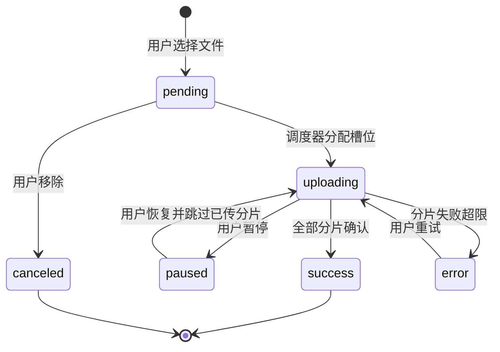

## R19-150：如何实现一个支持并发限制、断点续传的文件上传队列（状态机设计）？
**答**：
- 每个文件是一个状态机：`pending -> hashing -> uploading -> paused|success|error`，取消/暂停在 uploading 态生效，断点信息记录"已确认分片索引"。
- 并发控制：全局同时最多 N 个文件在传，队列调度器在任一槽位释放时取下一个 pending。
- 断点续传：大文件按 5MB 分片，逐片上传并携带 `uploadId + partNumber`；恢复时先向服务端查询已收分片，跳过重复传输。
- UI 状态全部由 `useReducer` 收敛，事件（PROGRESS/PAUSE/RESUME）与状态转移一一对应。



```tsx
// upload-queue.ts —— 并发限制 + 分片断点续传的上传队列
type FileState = 'pending' | 'uploading' | 'paused' | 'success' | 'error' | 'canceled';

type Task = {
  file: File;
  id: string;
  state: FileState;
  uploadedParts: Set<number>;   // 已确认分片，断点续传的依据
  controller?: AbortController; // 暂停/取消的实现载体
};

const CHUNK_SIZE = 5 * 1024 * 1024;
const MAX_CONCURRENT = 3;

export class UploadQueue {
  private tasks = new Map<string, Task>();
  private listeners = new Set<() => void>();   // 供 useSyncExternalStore 订阅

  subscribe = (cb: () => void) => {
    this.listeners.add(cb);
    return () => this.listeners.delete(cb);
  };
  getSnapshot = () => [...this.tasks.values()].map(t => ({ ...t, uploadedParts: [...t.uploadedParts].length }));

  add(file: File) {
    const id = crypto.randomUUID();
    this.tasks.set(id, { file, id, state: 'pending', uploadedParts: new Set() });
    this.emit();
    this.pump(); // 尝试填满并发槽位
    return id;
  }

  pause(id: string) {
    const t = this.tasks.get(id);
    if (t?.state === 'uploading') {
      t.controller?.abort();        // 中止在途分片，已确认分片保留
      t.state = 'paused';
      this.emit();
      this.pump();
    }
  }

  resume(id: string) {
    const t = this.tasks.get(id);
    if (t?.state === 'paused' || t?.state === 'error') {
      t.state = 'pending';
      this.emit();
      this.pump();                  // 恢复时从 uploadedParts 之后继续
    }
  }

  private pump() { // 并发调度：有空槽就启动 pending 任务
    const running = [...this.tasks.values()].filter(t => t.state === 'uploading').length;
    const slots = MAX_CONCURRENT - running;
    [...this.tasks.values()]
      .filter(t => t.state === 'pending')
      .slice(0, slots)
      .forEach(t => this.run(t));
  }

  private async run(t: Task) {
    t.state = 'uploading';
    t.controller = new AbortController();
    this.emit();

    const total = Math.ceil(t.file.size / CHUNK_SIZE);
    // 先问服务端已收到哪些分片 —— 断点续传的关键
    const acked: number[] = await fetch(`/api/upload/${t.id}/status`).then(r => r.json());
    acked.forEach(n => t.uploadedParts.add(n));

    try {
      for (let i = 0; i < total; i++) {
        if (t.uploadedParts.has(i)) continue;               // 跳过已传
        const chunk = t.file.slice(i * CHUNK_SIZE, (i + 1) * CHUNK_SIZE);
        const res = await fetch(`/api/upload/${t.id}/part`, {
          method: 'POST',
          body: chunk,
          signal: t.controller.signal,                      // 暂停即 abort
          headers: { 'X-Part-Number': String(i) },
        });
        if (!res.ok) throw new Error(`part ${i} failed`);
        t.uploadedParts.add(i);
        this.emit();                                        // 驱动进度条
      }
      await fetch(`/api/upload/${t.id}/complete`, { method: 'POST' });
      t.state = 'success';
    } catch (e) {
      t.state = (e as Error).name === 'AbortError' ? 'paused' : 'error';
    }
    this.emit();
    this.pump();
  }

  private emit() { this.listeners.forEach(l => l()); }
}

// useUploadQueue.ts —— React 侧：external store 接入
import { useSyncExternalStore } from 'react';
export function useUploadQueue(queue: UploadQueue) {
  return useSyncExternalStore(queue.subscribe, queue.getSnapshot, queue.getSnapshot);
}
```

## 第二十二章 大型项目架构（R19-151 ~ R19-157）
