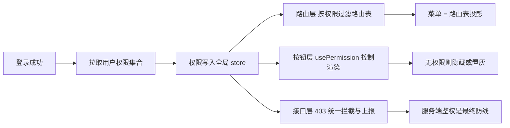

## R19-153：完整的权限系统怎么实现？路由权限、按钮权限、接口权限三层如何打通？
**答**：
- 三层各管一段：**路由层**决定"能不能进这个页面"（守卫 + 动态路由表）、**按钮层**决定"能不能点这个按钮"（usePermission + `<AuthButton>` 或直接条件渲染）、**接口层**是最后防线（前端拦 401/403，服务端真正鉴权）。
- 数据源统一：登录后拉取 permissions 集合（如 `['order:view', 'order:ship']`）存 store，三层都读同一份，保证一致。
- 路由表按 code 过滤生成，动态 addRoutes；菜单即路由表的投影，不会出现两份配置。
- 无权限的体验分层设计：页面级 403 页、按钮级隐藏或置灰、接口级统一拦截上报。



```tsx
// permission.tsx —— 三层权限体系
import { create } from 'zustand';
import { Navigate, Outlet, useLocation } from 'react-router-dom';

// 1. 权限源：单一事实来源
type AuthState = {
  perms: Set<string>;
  setPerms: (list: string[]) => void;
  has: (code: string) => boolean;
};
export const useAuth = create<AuthState>((set, get) => ({
  perms: new Set(),
  setPerms: list => set({ perms: new Set(list) }),
  has: code => get().perms.has(code),
}));

// 2. 路由层：按权限过滤路由表
type RouteDef = { path: string; element: React.ReactNode; code?: string; children?: RouteDef[] };

export function filterRoutes(routes: RouteDef[]): RouteDef[] {
  const { has } = useAuth.getState();
  return routes
    .filter(r => !r.code || has(r.code))
    .map(r => (r.children ? { ...r, children: filterRoutes(r.children) } : r));
}

export function RequirePerm({ code, children }: { code: string; children: React.ReactNode }) {
  const has = useAuth(s => s.has(code));
  const location = useLocation();
  if (!has(code)) {
    return <Navigate to="/403" replace state={{ from: location.pathname }} />;
  }
  return children;
}

// 3. 按钮层：权限组件 + hook 两种形态
export function AuthButton({ code, children, fallback = null }: {
  code: string; children: React.ReactNode; fallback?: React.ReactNode;
}) {
  const has = useAuth(s => s.has(code));
  return <>{has ? children : fallback}</>;
}
export function usePermission(code: string) {
  return useAuth(s => s.has(code));
}

// 使用示例
function OrderTable() {
  const canShip = usePermission('order:ship');
  return (
    <div>
      {/* 页面级守卫由路由层处理；这里只管操作列 */}
      <AuthButton code="order:ship" fallback={<span className="text-gray-400">无发货权限</span>}>
        <button>发货</button>
      </AuthButton>
      {canShip && <button>批量发货</button>}
    </div>
  );
}

// 4. 接口层：http 拦截器里统一处理 403（服务端始终是最终防线）
// http.ts: if (res.status === 403) reportAndToast('权限不足') ...
```
