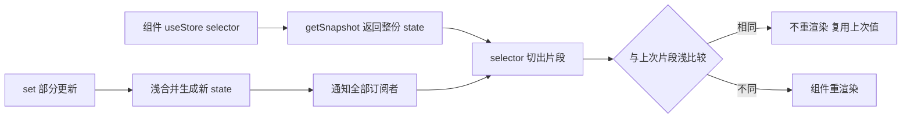

## R19-158：手写一个 zustand mini（create + selector + 浅比较）？
**答**：
- 内核极简：模块级 store 保存 state，setState 做 `Object.assign` 浅合并后通知订阅者。
- React 接入用 `useSyncExternalStore`：getSnapshot 返回 state，selector 切片 + `useRef` 缓存上次结果做**浅比较**，切片没变就不触发重渲染。
- 这就是 zustand "精确订阅"的本质：组件只关心自己 selector 出来的那一小片。
- 50 行以内可完整覆盖：create、set、get、subscribe、useStore(selector)。



```javascript
// zustand-mini.js —— 手写 zustand 核心（含 React 绑定）
import { useSyncExternalStore, useRef, useCallback } from 'react';

export function create(createState) {
  let state;
  const listeners = new Set();

  const setState = (partial) => {
    const next = typeof partial === 'function' ? partial(state) : partial;
    if (next !== state) {                       // 引用相同直接跳过
      state = { ...state, ...next };            // 浅合并（zustand 默认行为）
      listeners.forEach(l => l());
    }
  };

  const getState = () => state;
  const subscribe = (listener) => {
    listeners.add(listener);
    return () => listeners.delete(listener);
  };

  const api = { setState, getState, subscribe };

  // 初始化：支持 (set, get) => ({...}) 的 zustand 惯用形态
  state = createState(setState, getState);

  // React hook：selector 切片 + 浅比较
  function useStore(selector = s => s) {
    const lastSliceRef = useRef(null);

    // getSnapshot 恒返回整份 state —— useSyncExternalStore 需要缓存安全的快照
    const slice = useSyncExternalStore(
      subscribe,
      getState,
      getState,
    );
    const selected = selector(slice);

    // 浅比较缓存：切片引用没变，返回旧值让 React 跳过渲染
    const memoizedRef = useRef({ hasInit: false, value: undefined });
    if (
      !memoizedRef.current.hasInit ||
      !shallowEqual(memoizedRef.current.value, selected)
    ) {
      memoizedRef.current = { hasInit: true, value: selected };
    }
    return memoizedRef.current.value;
  }

  return { useStore, ...api };
}

function shallowEqual(a, b) {
  if (Object.is(a, b)) return true;
  if (typeof a !== 'object' || a === null || typeof b !== 'object' || b === null) return false;
  const ka = Object.keys(a), kb = Object.keys(b);
  if (ka.length !== kb.length) return false;
  return ka.every(k => Object.is(a[k], b[k]));
}

// ---- 使用：与 zustand 几乎同构 ----
const useCounter = create((set, get) => ({
  count: 0,
  user: { name: 'w' },
  inc: () => set(s => ({ count: s.count + 1 })),
}));

function CountDisplay() {
  const count = useCounter.useStore(s => s.count); // 只有 count 变才重渲染
  return <span>{count}</span>;
}
function UserDisplay() {
  const name = useCounter.useStore(s => s.user.name); // count 变化不影响
  return <span>{name}</span>;
}
```
