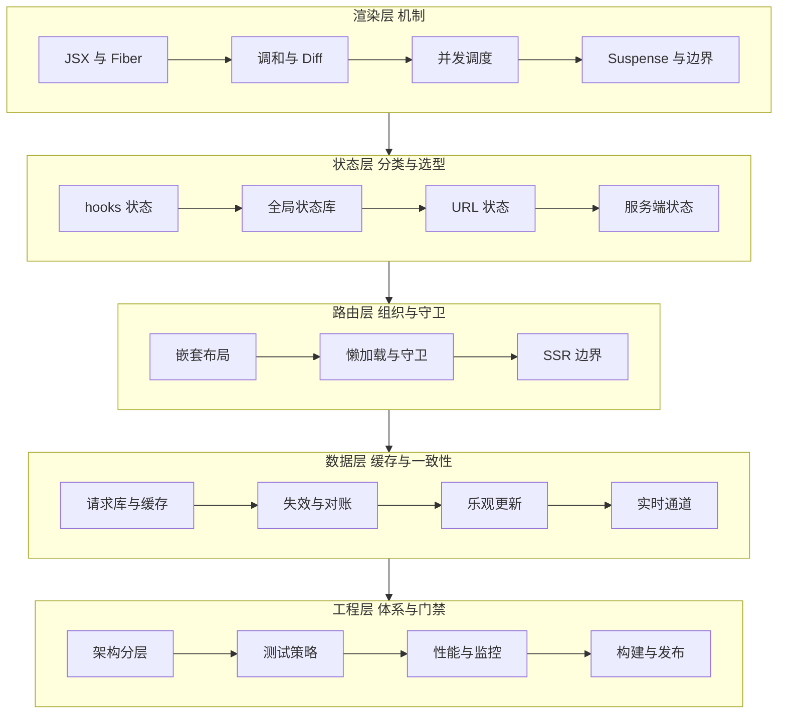

## R19-200：如何收束 React 的知识体系？请给一张五层地图。
**答**：
- 五层从下到上：**渲染层**（JSX/Fiber/调和/并发调度）、**状态层**（hooks/状态机/服务端状态/URL 状态）、**路由层**（嵌套布局/数据加载/SSR 边界）、**数据层**（缓存/失效/乐观更新/实时通道）、**工程层**（架构/测试/性能/监控/发布）。
- 记忆方式：越底层越稳定（多年不变），越上层越随业务演进；面试深度优先打穿一层，广度用地图收束。
- 每层答法锚点：渲染层讲"机制"，状态层讲"分类与选型"，路由层讲"组织与守卫"，数据层讲"缓存与一致性"，工程层讲"体系与门禁"。



```javascript
// react-map.js —— 五层知识地图（自查清单，每层能答出 5 个问题即达标）

// 1. 渲染层（机制）
// - JSX 编译产物与 ReactElement 结构
// - Fiber 双缓存与可中断渲染
// - Diff 三策略与 key 的意义
// - 并发调度优先级与 lane
// - commit 阶段：insertionEffect -> layoutEffect -> paint -> passiveEffect

// 2. 状态层（分类与选型）
// - hooks 心智：快照语义 / 闭包陷阱 / 依赖数组
// - 状态四分类：local / url / global / server（R19-162 决策树）
// - 受控与非受控边界
// - Context 的粒度与代价
// - reducer 化复杂状态转换

// 3. 路由层（组织与守卫）
// - 嵌套布局与 Outlet
// - 懒加载与路由级分包
// - 守卫三实现：布局组件 / loader / middleware
// - SSR 边界：'use client' 划线与 hydration
// - URL 即状态：查询参数同步（R19-147）

// 4. 数据层（缓存与一致性）
// - 缓存 key 设计与失效面（R19-146）
// - 乐观更新与回滚（R19-148）
// - 竞态三修复（R19-143）
// - 轮询/推送/SSE 选型（R19-149）
// - 离线与弱网策略（R19-177 / R19-194）

// 5. 工程层（体系与门禁）
// - FSD 分层与依赖方向（R19-151）
// - 权限/错误/主题/i18n 四大横切体系（R19-153~156）
// - 测试金字塔与门禁（R19-163~167）
// - 性能排查链路（R19-198）
// - 发布流与灰度回滚（R19-197）

export const REACT_MAP_VERSION = 'r19';
// 面试收束话术：
// "我的知识体系是五层的：渲染讲机制、状态讲选型、路由讲组织、数据讲一致性、工程讲体系。
//  任何 React 问题我都能先定位到层，再给机制 + 场景 + 权衡。"
```

## 追问（补充）

**追问**：

1. 五层里哪一层最容易被追问到源码级，为什么？ → 渲染层。Fiber 双缓存、lane 优先级、commit 三段是所有框架对比的公共底座，只背结论一层就会被问穿；建议准备 diff 与批处理两个能讲到函数级的点。
2. 候选人只有业务经验、没有底层积累，怎么用这张图收敛回答？ → 从状态层与数据层切入，用"状态四分类选型"和"缓存失效与一致性"的真实决策撑深度，再往渲染层补两个能说清机制的点，避免全线泛泛而谈。
3. React 19 的新东西该挂到哪一层？ → RSC 与 Server Action 落在数据层与路由层的边界上，Compiler 属工程层的构建期优化，use、useOptimistic 归状态层；不需要新增层，反而验证了分层是稳定的。
