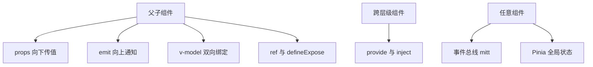

## V3-027：在组合式函数中注册生命周期钩子要注意什么？
**答**：
- 生命周期钩子必须在 setup 的同步调用链中注册，composable 内部注册是合法且推荐的。
- 放在 setTimeout/Promise.then 等异步回调里注册会失效，因为已脱离组件实例上下文。
- composable 封装"注册监听 + 卸载清理"是标准模式。
- 与组件实例无关的场景用 onScopeDispose 代替 onUnmounted。

```vue
<script setup lang="ts">
import { onMounted, onBeforeUnmount } from "vue";

// composable 内部注册生命周期钩子：必须在 setup 同步调用链中执行
function useEventListener(
  target: Window,
  event: string,
  handler: EventListener
) {
  onMounted(() => target.addEventListener(event, handler));
  onBeforeUnmount(() => target.removeEventListener(event, handler));
}

// 正确：setup 中同步调用
useEventListener(window, "resize", () => console.log("resize"));

// 错误示例：放在异步回调里注册会失效
// setTimeout(() => useEventListener(window, "resize", fn), 1000);
</script>

<template>
  <p>调整窗口大小查看控制台</p>
</template>
```

## 第六章 组件通信

常见组件通信方式与适用层级如下图，选型的核心依据是"组件之间的层级关系与数据归属"。


