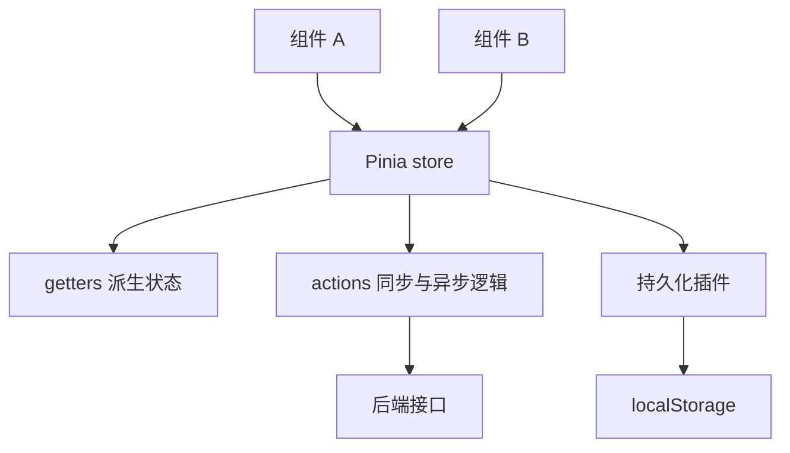

## V3-048：Vue3 插件机制是如何工作的？
**答**：
- 插件是带 install 方法的对象（或直接是函数），`app.use(plugin)` 自动调用 install。
- install 接收 app 实例与可选配置，可以注册全局组件、指令、provide、globalProperties。
- app.use 对同一插件只会安装一次（按对象引用去重）。
- Vue Router、Pinia、i18n 都基于该机制。

```typescript
// plugins/i18n.ts —— 插件就是一个带 install 方法的对象或函数
import type { App } from "vue";

export interface I18nOptions {
  locale: string;
}

export function createI18n(options: I18nOptions) {
  return {
    install(app: App) {
      // 注册全局属性 / 指令 / provide
      app.config.globalProperties.$t = (key: string) =>
        `[${options.locale}] ${key}`;
      app.provide("locale", options.locale);
      app.directive("i18n", {
        mounted(el: HTMLElement, binding: { value: string }) {
          el.textContent = `[${options.locale}] ${binding.value}`;
        },
      });
    },
  };
}

// main.ts 中：
// const app = createApp(App);
// app.use(createI18n({ locale: "zh-CN" })); // 自动调用 install 并传入 app
```

## 第十四章 Pinia 状态管理

Pinia 与组件的关系：多个组件共享同一个 store 实例，getter 派生状态，action 承载同步与异步逻辑，持久化插件把 state 同步到 localStorage。


