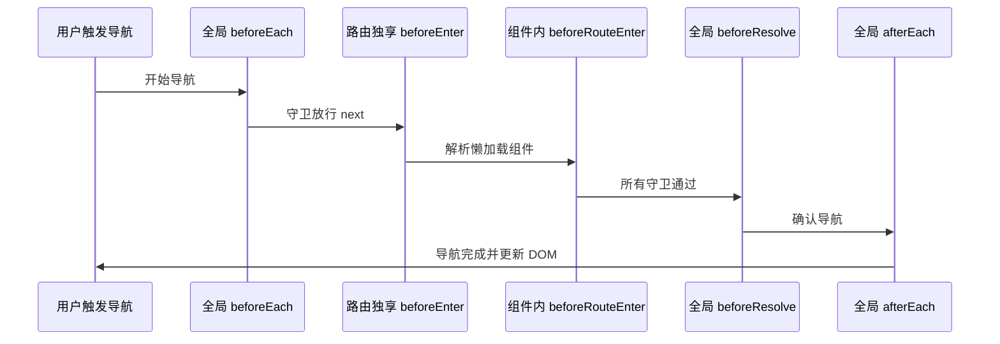

## V3-054：Pinia 的 storeToRefs 解决什么问题？
**答**：
- 直接解构 store 会丢失响应式（state 变成普通值、action 没问题）。
- storeToRefs 只把 state 和 getters 转成 ref，action 保持原样可以直接解构。
- 其内部基于 toRefs 并跳过函数属性。
- 忘记用它是最常见的 Pinia 响应式丢失事故。

```vue
<script setup lang="ts">
import { useCounterStore } from "@/stores/counter";
import { storeToRefs } from "pinia";

const store = useCounterStore();

// 错误：解构丢失响应式
// const { count, double } = store;

// 正确：storeToRefs 只转换 state 与 getters
const { count, double } = storeToRefs(store);

// action 不是响应式值，直接解构即可
const { increment } = store;
</script>

<template>
  <p>{{ count }} - {{ double }}</p>
  <button @click="increment">加一</button>
</template>
```

## 第十五章 Vue Router4

一次导航中各类守卫的执行顺序如下图，理解顺序才能正确做鉴权与重定向。


