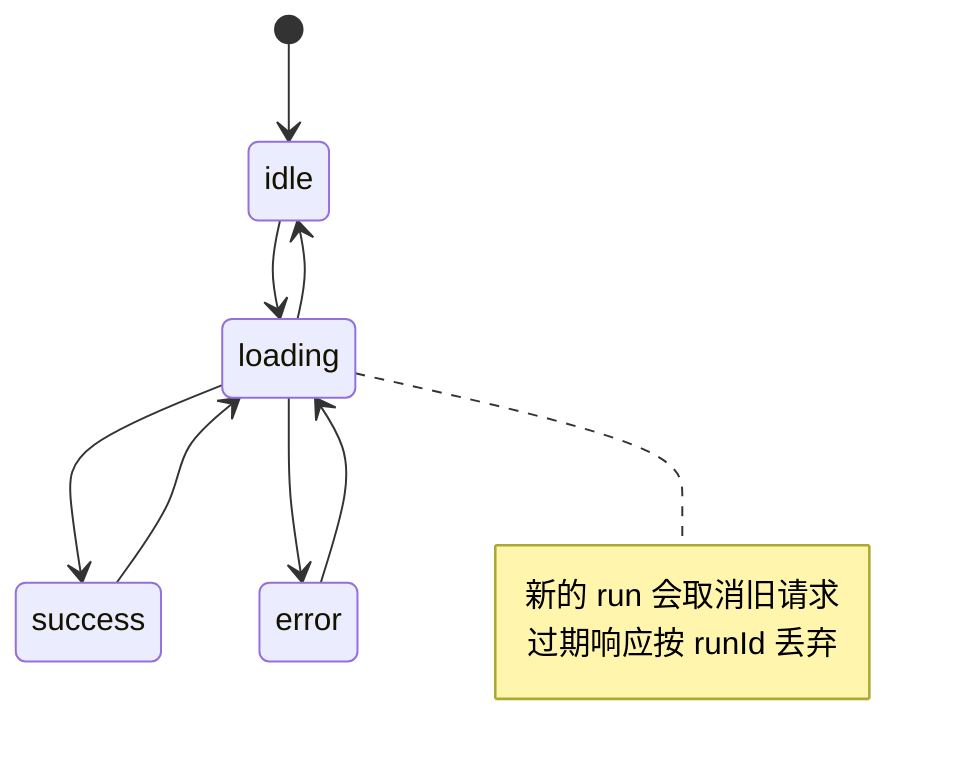

## V3-077：组件库如何做 Provide/Inject 的类型安全封装？
**答**：
- 用 `InjectionKey<T>` 作为 provide 的 key，inject 时自动推导出上下文类型，杜绝 string key 的 any。
- 封装成 `provideXxx` / `useXxx` 一对函数：provide 负责注入，use 负责取用并做缺失兜底。
- 缺失时抛出带指引的错误（“必须在外层调用 provideXxx”），把运行时问题前移到开发期。
- key 用 Symbol 保证唯一，避免跨库同名冲突。

```typescript
// context/useFormContext.ts
import { inject, provide, type InjectionKey } from "vue";

export interface FormContext {
  model: Record<string, unknown>;
  disabled: boolean;
  validateField: (prop: string) => Promise<boolean>;
}

export const formKey: InjectionKey<FormContext> = Symbol("form-context");

// 提供方：表单容器组件里调用
export function provideFormContext(ctx: FormContext) {
  provide(formKey, ctx);
}

// 消费方：表单控件里调用，类型自动推导为 FormContext
export function useFormContext() {
  const ctx = inject(formKey);
  if (!ctx) {
    throw new Error("useFormContext 必须在 provideFormContext 之后的组件树中使用");
  }
  return ctx;
}

// 组件里使用：
// const { model, validateField } = useFormContext();
// await validateField("username"); // 类型完整，无需断言
```

## 第二十二章 组合式函数库设计

手写 useRequest / useFetch / usePagination 等组合式函数是 Vue3 面试的压轴高频题，考察异步竞态、生命周期清理与类型设计。


