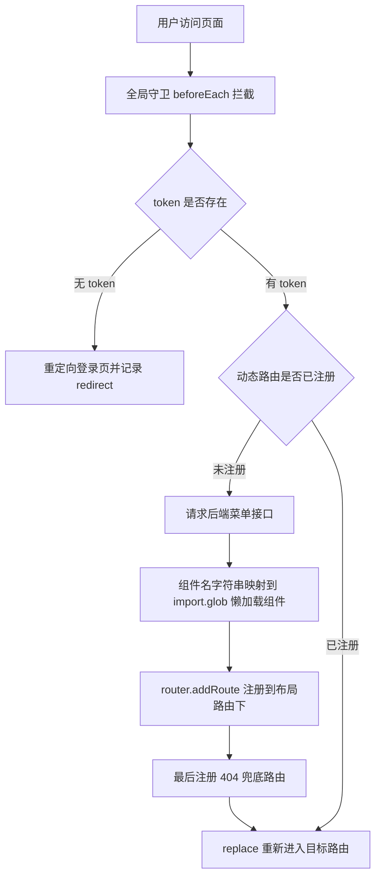

## V3-091：跨 store 的派生数据怎么组织？
**答**：
- 两种方案：写进某个 store 的 getter（内部引用其它 store），或抽出独立的 useXxxSummary 组合式函数。
- 派生逻辑被多处使用、或组合了两个以上 store 时，独立 composable 更清晰，也不加剧 store 耦合。
- computed 依赖两个 store 的响应式状态，任何一方变化都会重新计算并缓存。
- 不要把派生结果存回 state，那会引入双份事实。

```typescript
// composables/useCartSummary.ts —— 组合多个 store 的派生数据
import { computed } from "vue";
import { useCartStore } from "@/stores/modules/cart";
import { useCouponStore } from "@/stores/modules/coupon";

export function useCartSummary() {
  const cart = useCartStore();
  const coupon = useCouponStore();

  // 依赖两个 store 的状态，任一方变化都会重新计算
  const goodsTotal = computed(() =>
    cart.items.reduce((sum, item) => sum + item.price * item.count, 0)
  );

  const discount = computed(() => Math.min(coupon.current?.amount ?? 0, goodsTotal.value));

  const payable = computed(() => goodsTotal.value - discount.value);

  return { goodsTotal, discount, payable };
}

// 备选：直接放进 cart store 的 getter，getter 内部 useCouponStore()
// 代价是 cart 从此依赖 coupon，耦合更紧，按需选择
```

## 第二十四章 路由工程

动态路由权限、meta 工程化、嵌套布局、预取与查询参数封装，是 Router4 在中后台场景的核心考法。


