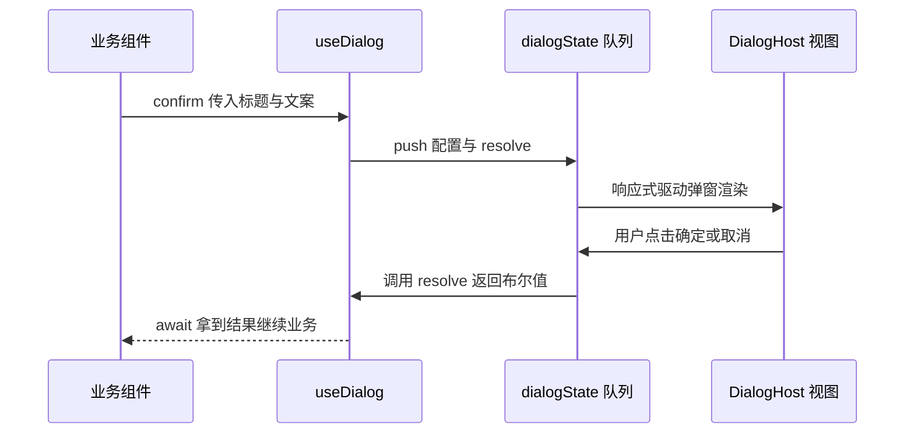

## V3-103：如何把表单筛选状态与 URL 同步（可分享的链接）？
**答**：
- 筛选条件写入 query：刷新、前进后退、复制链接给别人都还原同一视图。
- 初始化：从 route.query 读初始值合并默认值；变化：watch filters 深度监听后 replace 到 URL。
- 只把非默认值写进 URL，链接干净；空值删除参数而不是写 `keyword=`。
- 用 replace 不用 push，避免每次输入都产生一条历史记录。

```typescript
// composables/useUrlFilters.ts
import { reactive, watch } from "vue";
import { useRoute, useRouter } from "vue-router";

export function useUrlFilters<T extends Record<string, string | number | undefined>>(
  defaults: T
) {
  const route = useRoute();
  const router = useRouter();

  // 1. 初始化：URL 参数优先，缺失用默认值
  const filters = reactive<T>({ ...defaults });
  for (const key in defaults) {
    const raw = route.query[key];
    if (typeof raw === "string" && raw !== "") {
      filters[key] = typeof defaults[key] === "number" ? (Number(raw) as never) : (raw as never);
    }
  }

  // 2. 变化同步回 URL：replace 避免历史记录爆炸
  watch(
    filters,
    () => {
      const query: Record<string, string> = {};
      for (const key in filters) {
        const value = filters[key];
        // 只写非默认值，保持链接干净可分享
        if (value !== undefined && value !== defaults[key]) query[key] = String(value);
      }
      router.replace({ query });
    },
    { deep: true }
  );

  return filters;
}

// 使用：
// const filters = useUrlFilters({ keyword: "", page: 1, status: undefined });
// filters.keyword = "vue"; // URL 自动变成 ?keyword=vue，可直接分享
```

## 第二十六章 UI 交互模式

全局弹窗、右键菜单、拖拽排序、无限滚动、可编辑表格与命令面板，是考察组件交互设计能力的六个经典模式。


